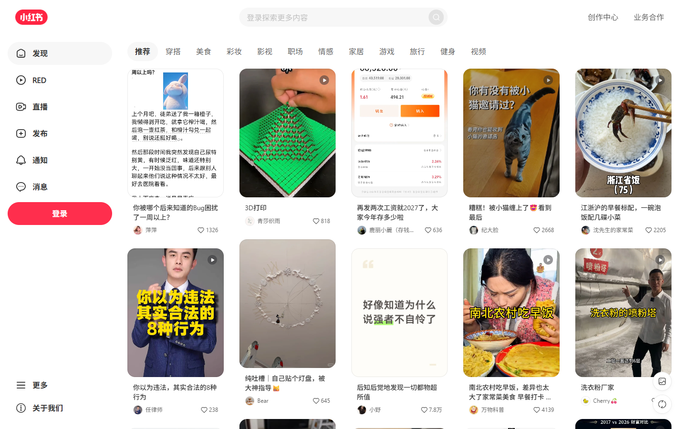
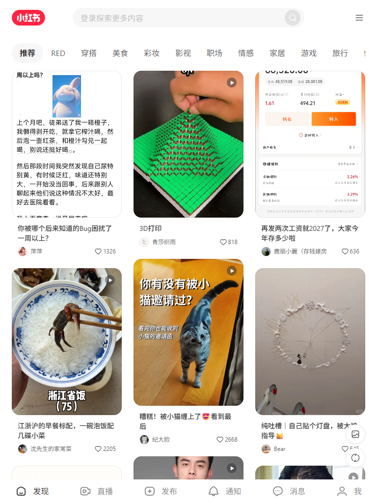
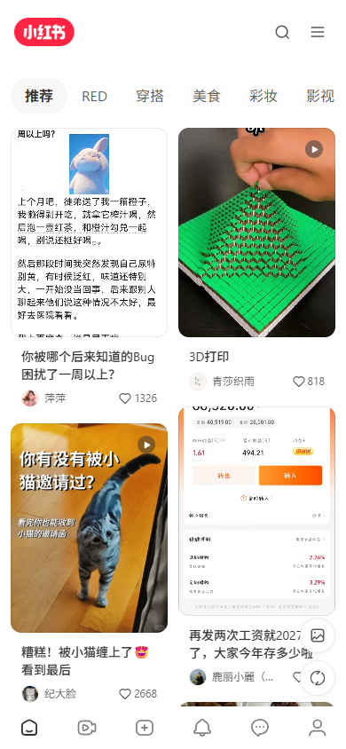
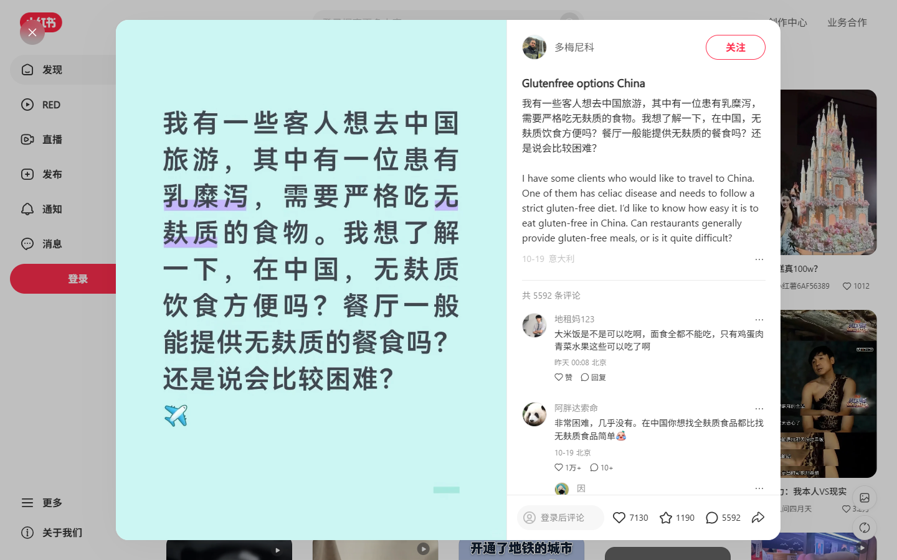

# 小红书 Web · UI/UX 设计 DNA

> 提取对象：`https://www.xiaohongshu.com/explore` 与笔记详情弹层。
> 提取日期：2026-11-18。采样视口：1440×900、768×1024、390×844。
> 采样页面：发现信息流、笔记详情（双栏弹层）、响应式布局。
> 方法：浏览器真实渲染 + computed style 采样；登录弹层已关闭，内容区可见。
> 用途：替换「轻享图文」原先的 MonaHub UI 基线；工程骨架仍用 SSM/JSP，不在本文范围。

---

## 0. 快速参考卡

- **画布**：纯白 `#FFFFFF`；文字 `#333333`；次级文字 `rgba(51,51,51,.6)`；弱文字 `rgba(51,51,51,.3)`。
- **品牌红**：`#FF2442`；主按钮实色 `#FF2E4D`；红色只用于品牌、登录/发布、关注描边、关键 CTA。
- **字体**：system-ui + 苹方/微软雅黑；正文 14px，卡片标题 14/500，导航与按钮 16/600，详情标题 18/600。
- **形状**：媒体圆角 16px，弹层圆角 20px，按钮/搜索/标签胶囊 999px；卡片**无边框、无阴影**。
- **布局**：顶栏 72px；桌面左栏 219px；信息流桌面 5 列 / 平板 3 列 / 手机 2 列；卡片封面 3:4。
- **氛围**：白、轻、内容优先、红色点睛、动效克制；不是玻璃拟态，也不是暗色科技风。

---

## 1. 氛围判断

| 维度 | 评分 | 依据 |
|---|---|---|
| 信息密度 | 7/10 | 5 列瀑布流，屏幕内 10+ 卡片；但留白足够，不拥挤 |
| 布局变异 | 6/10 | 卡片高度随封面变化，列与列错落；整体仍对齐 |
| 动效强度 | 2/10 | 以颜色/背景过渡为主，卡片不抬升、不缩放 |
| 类型 | 消费级内容社区 / 生活方式信息流 | 图片优先、作者与点赞信息极简 |
| 情绪词 | 轻盈、日常、温暖、内容优先、克制 | 白底、红点、圆角图片、弱化 chrome |

**一句话**：让内容（封面）占绝对主角，UI 只留白色画布、黑色文字和一记红色。

---

## 2. 色彩系统

### 2.1 核心令牌

| 角色 | 取值 | 用法 |
|---|---|---|
| 画布 `canvas` | `#FFFFFF` | 页面、侧栏、顶栏、卡片背景 |
| 主文字 `text` | `#333333` | 标题、正文、导航 |
| 次文字 `text-secondary` | `rgba(51,51,51,.6)` | 评论数、说明、次级标签 |
| 作者/操作文字 | `rgba(51,51,51,.8)` | 卡片作者名、操作按钮 |
| 弱文字 `text-muted` | `rgba(51,51,51,.3)` | 时间、占位符、禁用 |
| 品牌红 `brand` | `#FF2442` | Logo、品牌强调、红色图标 |
| 主按钮红 `brand-strong` | `#FF2E4D` | 登录、发布、主 CTA |
| 填充灰 `fill` | `rgba(0,0,0,.03)` | 搜索框、标签胶囊、输入框、浅底按钮 |
| 分隔线（适配） | `rgba(0,0,0,.08)` | 后台表格/设置页；信息流不用 |
| 遮罩 | `rgba(0,0,0,.25)` | 详情弹层背景 |

### 2.2 使用规则

- 红色面积控制在屏幕的 5% 以内；一屏通常只有 Logo、登录/发布、关注描边、点赞激活态用到红。
- 不使用渐变、玻璃拟态、彩色阴影；所有质感来自图片与留白。
- 链接不默认蓝色；文字链接用黑色或品牌红。
- 本次采样未观察到深色模式入口；按浅色单主题处理，不假设存在暗色系统。
- 状态色（轻享图文适配）：成功 `#15803D`、警告 `#B45309`、危险 `#DC2626`、下架 `#7C3AED`、草稿 `#8A929F`；用浅底 + 深字，不用大面积实色。

---

## 3. 字体系统

### 3.1 字体栈

```css
font-family: system-ui, -apple-system, "PingFang SC", "Microsoft YaHei",
             "Helvetica Neue", Arial, sans-serif;
```

- 不加载 Web Font；中文走系统苹方/微软雅黑。
- 不用衬线体、不用全大写、不用夸张字距。

### 3.2 字号/字重

| 层级 | 字号/行高 | 字重 | 用途 |
|---|---|---|---|
| 详情标题 `h1` | 18 / 25.2（1.4） | 600 | 笔记详情标题 |
| 导航/按钮 | 16 / 18.4–19.2（1.15–1.2） | 600 | 顶栏按钮、频道、关注 |
| 详情作者 | 16 / 40 | 400 | 作者名 |
| 卡片标题 | 14 / 19.6（1.4） | 500 | 信息流标题 |
| 正文/评论 | 14 / 16.1（1.15） | 400 | 正文、评论、说明 |
| 卡片作者/点赞 | 12 / 13.8（1.15） | 400 | 卡片 meta |
| 时间/弱信息 | 12 / 16 | 400 | 时间、地点、占位 |

**规则**：

- 正文最大 16px；信息流标题只有 14px，靠图片和留白建立层级，而不是靠大字。
- 字重只用 400 / 500 / 600；不用 700+。
- 行高：标题 1.4，正文/导航 1.15–1.2；中文正文不拉太松。
- 数字/点赞数用同一字体，不做等宽；大数用“2.4万”缩写。

---

## 4. 间距与网格

### 4.1 基础单位

- 基础 4px；常用阶梯：**4 / 8 / 12 / 16 / 24 / 32**。
- 卡片内边距 12；卡片标题下间距 8；卡片之间水平 32（桌面）/24（平板）/12（手机），垂直约 16。
- 弹层内边距 24；评论区左右 8；操作栏上下 16。

### 4.2 布局尺寸（1440×900）

| 元素 | 尺寸/位置 |
|---|---|
| 顶栏 | 高 72，`position: fixed`，白底 |
| 左栏 | 宽 218.7，左边距 16，顶栏下 16，白底 |
| 内容区 | 从 x≈235 开始，内边距 `72px 32px 0` |
| 信息流容器 | 宽 1141.3，5 列 |
| 卡片 | 宽 202.7，封面 202.7×270（3:4），整卡高约 341.6 |
| 列间距 | ≈32 |
| 行间距 | ≈16 |
| 搜索框 | 437×40，圆角 999 |
| 频道标签 | 高 40，宽 64，圆角 999 |

### 4.3 响应式

| 视口 | 列数 | 卡片宽 | 间距 | 导航 |
|---|---|---|---|---|
| 1440 | 5 | 202.7 | 32 | 左侧栏 219 |
| 768 | 3 | 224 | 24 | 侧栏隐藏；底部导航 |
| 390 | 2 | 177 | 12 | 底部导航；搜索收成图标 |

- 桌面是“固定顶栏 + 固定左栏 + 独立滚动信息流”；移动端是“固定顶栏 + 横向频道 + 底部导航”。
- 信息流用绝对定位的瀑布流（卡片 `position: absolute`，容器高度动态计算）；轻享图文如果封面固定 3:4，可用 CSS Grid/Columns 达到同样节奏，不必上 JS masonry。

---

## 5. 形状与层级

### 5.1 圆角

| 元素 | 圆角 |
|---|---|
| 信息流封面 | 16px |
| 详情弹层 | 20px |
| 详情左媒体区 | 20px 0 0 20px |
| 搜索框 / 频道胶囊 / 按钮 | 999px（或 100px） |
| 评论输入框 | 20px |
| 头像 | 50% |
| 后台小标签（适配） | 8–12px |

### 5.2 阴影/边框

- **卡片无边框、无阴影**；卡片与背景之间只靠留白和图片圆角分隔。
- **弹层**：`0 8px 64px rgba(0,0,0,.04), 0 1px 4px rgba(0,0,0,.02)`；描边无。
- 遮罩：`rgba(0,0,0,.25)`。
- 后台表格可用 `1px solid rgba(0,0,0,.08)` 的细线，但信息流不要加。

---

## 6. 布局哲学

1. **图片优先**：封面占据卡片 79%（270/341.6），文字信息只占底部 21%。
2. **chrome 极简**：没有面包屑、没有卡片外框、没有多余分割线；导航只保留图标 + 短词。
3. **左栏稳定、内容流动**：顶栏与左栏固定，信息流独立滚动；用户不会因为滚动丢失导航。
4. **频道是横向胶囊**：当前频道用浅灰胶囊，不用红色下划线；切换只换内容，不换布局。
5. **详情是双栏弹层**：左媒体 627、右内容 439，弹层 1066×836；遮罩变暗，背景信息流保留上下文。
6. **移动端底部导航**：发现 / 直播 / 发布（中心 +）/ 通知 / 消息 / 我；发布是视觉中心。

---

## 7. 组件模式

### 7.1 顶栏

- 高 72，白底，固定；左侧 Logo 68×32；中间搜索；右侧文字按钮“创作中心 / 业务合作”（16/600，透明底，圆角 100）。
- 移动端：Logo 左、搜索图标右、汉堡菜单；搜索输入收起。

### 7.2 左栏

- 宽 219，白底；菜单项高 48，图标 24 + 文字 16/600，左内边距 16，图标与文字间距 12。
- 当前项：浅灰胶囊底（`rgba(0,0,0,.03)`）+ 深色文字；不是红色块。
- 登录按钮：219×48，红底白字，圆角 100，16/600。
- 底部“更多 / 关于我们”弱化，12–14px。

### 7.3 搜索

- 437×40，圆角 999，底 `rgba(0,0,0,.03)`，无边框。
- 左内边距 16，右侧搜索图标 40×40；占位文字 `rgba(51,51,51,.3)`，16px。
- 聚焦不放大、不加阴影；只加深底色或显示光标。

### 7.4 频道标签

- 高 40，圆角 999，左右内边距 16，字号 16。
- 未选中：透明底，`rgba(51,51,51,.8)`，400。
- 选中：浅灰底 `rgba(0,0,0,.03)`，`#333`，600。
- 不用红色下划线、不用大色块。

### 7.5 信息流卡片

- 外层无背景、无边框、无阴影；封面 3:4，圆角 16，`object-fit: cover`。
- 底部 footer 内边距 12；标题 14/500/1.4，最多 2 行；标题下 8。
- 作者行：头像 20 圆形 + 名字 12（`rgba(51,51,51,.8)`）；右侧点赞图标 16 + 数字 12（`rgba(51,51,51,.6)`）。
- 卡片总高 ≈342；卡片之间水平 32 / 垂直 16。
- 没有“卡片 hover 抬升”；hover 只做封面遮罩/颜色过渡。

### 7.6 详情弹层

- 1066×836，圆角 20，白底；遮罩 `rgba(0,0,0,.25)`。
- 左媒体 627×836，圆角 20 0 0 20，底 `rgba(0,0,0,.03)`；图片/视频填充。
- 右栏 439，内边距 24；顶部作者行 40 高：头像 40 + 名字 16/400 + 关注按钮 96×40（红描边、红字、圆角 100、16/600）。
- 标题 18/600/1.4，下 8；正文 14/1.15；日期/地点 14，`rgba(51,51,51,.3)`。
- 评论区：标题“共 N 条评论”14，`rgba(51,51,51,.6)`；评论项 padding 8，姓名 14 `rgba(51,51,51,.6)`，正文 14 `#333`，时间/地点 12 弱化；点赞/回复 12。
- 底部操作栏 439×73，上内边距 16；评论输入 140×40，圆角 20，底 `rgba(0,0,0,.03)`；右侧点赞/收藏/评论/分享图标 24 + 数字 14。
- 弹层内不出现第二个大标题；标题只在右栏顶部出现一次。

### 7.7 按钮

| 类型 | 规格 |
|---|---|
| 主按钮 | 高 40，圆角 100，红底 `#FF2E4D`，白字 16/600，左右 24 |
| 描边按钮 | 高 40，圆角 100，1px `#FF2E4D`，红字 16/600，左右 24 |
| 文字按钮 | 高 40，透明底，`rgba(51,51,51,.8)` 16/600，左右 16 |
| 图标按钮 | 40×40，圆角 50%，无边框 |

- 按钮不投影；hover 只变底色/透明度；active 轻微下沉 1px 或不处理。

### 7.8 评论输入

- 40 高，圆角 20，底 `rgba(0,0,0,.03)`，占位 16 `rgba(51,51,51,.3)`；左侧图标 24。
- 聚焦不放大；发送按钮出现在右侧，红色文字或红色小按钮。

---

## 8. 动效

- **动效强度低**：页面没有入场动画、没有滚动视差、没有卡片抬升。
- 过渡以 `background-color / color / opacity` 为主，约 0.2s；弹层出现/消失用淡入 + 轻微位移即可。
- 不做 spring/bounce；不做 3D hover；不做大面积渐变流动。
- 轻享图文可保留 0.15–0.2s 的按钮/卡片颜色过渡；列表滚动不做动画。

---

## 9. 图像与媒体

- 封面统一 3:4，圆角 16，`object-fit: cover`；无边框、无阴影。
- 头像圆形，信息流 20px，详情 40px，评论 32px。
- 图标线性、24px、1.5–2px 描边；不用彩色填充图标（红色激活态除外）。
- 图片上的文字属于内容，不是 UI；UI 不叠加装饰性文字。
- 轻享图文的自动封面适配：3:4 纯色块 + 标题（最多 3 行）+ 分类小字；标题就是封面主体，卡片下方不再重复标题。

---

## 10. 反模式（不要做）

1. 不给信息流卡片加外框、阴影、悬浮抬升。
2. 不用渐变、玻璃拟态、彩色光晕。
3. 不用深色底 + 霓虹色；本次采样是浅色单主题。
4. 不做大 Hero/Banner 占据首屏；内容直接开始。
5. 不用大圆角 32px+ 的“软糖”卡片；媒体 16、弹层 20 足够。
6. 不用粗分割线；靠留白分组。
7. 不用全大写、宽字距、衬线标题。
8. 不把红色铺满按钮区/导航区；红色是点睛，不是背景。
9. 不用卡片内再套卡片；层级靠图片、字号、留白。
10. 不复制小红书 Logo/品牌资产；只借用设计语言。

---

## 11. 适配到「轻享图文」

### 11.1 设计令牌

```css
:root {
  --bg: #ffffff;
  --surface: #ffffff;
  --fill: rgba(0, 0, 0, 0.03);
  --border: rgba(0, 0, 0, 0.08); /* 仅后台表格/设置页 */
  --fg: #333333;
  --fg-dim: rgba(51, 51, 51, 0.6);
  --fg-mute: rgba(51, 51, 51, 0.3);
  --brand: #ff2442;
  --brand-strong: #ff2e4d;
  --radius-media: 16px;
  --radius-modal: 20px;
  --radius-pill: 999px;
  --shadow-modal: 0 8px 64px rgba(0, 0, 0, 0.04),
                  0 1px 4px rgba(0, 0, 0, 0.02);
  --font: system-ui, -apple-system, "PingFang SC", "Microsoft YaHei",
          "Helvetica Neue", Arial, sans-serif;
}
```

### 11.2 页面映射

| 轻享图文页面 | 小红书对应 | 采用方式 |
|---|---|---|
| 首页信息流 | 发现信息流 | 白底、5/3/2 列、3:4 自动封面、16 圆角、无卡片阴影 |
| 关注流 | 发现信息流 | 同一套卡片，只换数据源；空态引导去发现 |
| 文章详情 | 笔记详情弹层 | 桌面 1066×836 双栏；移动端全屏；左封面/右内容 |
| 创作页 | 发布页（未采样） | 沿用同一字体/间距/按钮；表单不做重装饰 |
| 作者主页 | 个人主页（未采样） | 头像 40、昵称 16、粉丝/关注 12、内容用同一卡片 |
| 后台审核/分类/用户/日志 | 无直接对应 | 保留小红书字体/间距/红色 CTA；表格用细线，不用卡片阴影 |
| 通知中心 | 无直接对应 | 白底列表、未读红点、12/14 字号；不做彩色卡片 |

### 11.3 布局落地

- 顶栏 72；桌面左栏 219；内容区左边距 235；内边距 32；移动端隐藏左栏，用底部导航。
- 首页：1440 5 列、768 3 列、390 2 列；卡片宽随列数；封面 3:4；水平间距 32/24/12，垂直 16。
- 详情：桌面用 1066×836 弹层；移动端全屏；左封面 3:4，右栏 439；底部操作栏固定。
- 按钮/搜索/频道一律 40 高、胶囊；主按钮红、关注描边红。
- 不做深色主题（M1）；深色 M2 再单独提取，不把浅色反转。

### 11.4 与自动封面的结合

- 卡片封面：3:4 纯色块 + 标题（18/600，最多 3 行）+ 分类小字；无图片请求。
- 卡片 footer：作者 12 + 点赞/评论 12；不再重复标题。
- 详情：同一 `cover_color` 作为左栏/顶部媒体底；标题在媒体内或右栏只出现一次。
- 因为封面固定 3:4，信息流可用 CSS Grid/Columns；不需要小红书的绝对定位 JS 瀑布流。

---

## 12. 测量证据

| 元素 | 关键值 | 采样 |
|---|---|---|
| 画布 | `#FFFFFF`，文字 `#333333` | body computed |
| 品牌红 | `--color-red: #ff2442`；登录按钮 `rgb(255,46,77)` | CSS var / button |
| 顶栏 | 1440×72，fixed | `.header-container` |
| 左栏 | 218.7×828，x16，y72，fixed | `.side-bar` |
| 信息流 | x266.7，宽 1141.3，5 列 | `.feeds-container` / `.note-item` |
| 卡片 | 202.7×341.6；封面 202.7×270，圆角 16 | `.note-item` / `.cover` |
| 卡片标题 | 14px / 500 / 19.6 | `.title` |
| 卡片作者/点赞 | 12px / 400 / 13.8；颜色 `.8` / `.6` | `.author-wrapper` / `.like-wrapper` |
| 卡片 footer | 高 71.6，padding 12；标题下 8 | `.footer` |
| 搜索 | 437×40，圆角 999，底 `rgba(0,0,0,.03)` | `.search-input` |
| 频道选中 | 64×40，圆角 999，底 `rgba(0,0,0,.03)`，16/600 | `.active.channel` |
| 详情弹层 | 1066×836，圆角 20，阴影 `0 8px 64px rgba(0,0,0,.04)` | `.note-container` |
| 详情媒体 | 627×836，圆角 20 0 0 20，底 `rgba(0,0,0,.03)` | `.media-container` |
| 详情标题 | 18 / 600 / 25.2 | `.title` (h1) |
| 详情关注 | 96×40，圆角 100，1px `#ff2e4d` | `.follow-button` |
| 评论项 | padding 8；姓名 14 `.6`；正文 14 | `.comment-item` |
| 操作栏 | 439×73，padding 16 16 0；输入 140×40，圆角 20 | `.interactions` |
| 遮罩 | `rgba(0,0,0,.25)` | `.note-detail-mask` |
| 768 | 3 列，卡片 224，间距 24，侧栏隐藏 | 响应式采样 |
| 390 | 2 列，卡片 177，间距 12，搜索收图标，底部导航 | 响应式采样 |

---

## 13. 截图









---

## 14. 不确定性与边界

- 登录弹层、发布页、个人主页未完整采样；本文的发布/主页建议是“同一设计语言的外推”，不是实测。
- 动效只观察到颜色/背景过渡；未观察到卡片抬升、视差或滚动动画。
- 未观察深色模式；M1 按浅色单主题。
- 评论区的深层回复、长文展开、图片查看器等未完整采样；轻享图文按“一级评论 + 一层回复”简化。
- 小红书的瀑布流是绝对定位 JS 实现；轻享图文的自动封面固定 3:4，可用 CSS Grid/Columns 达到近似效果，避免不必要的 JS。
