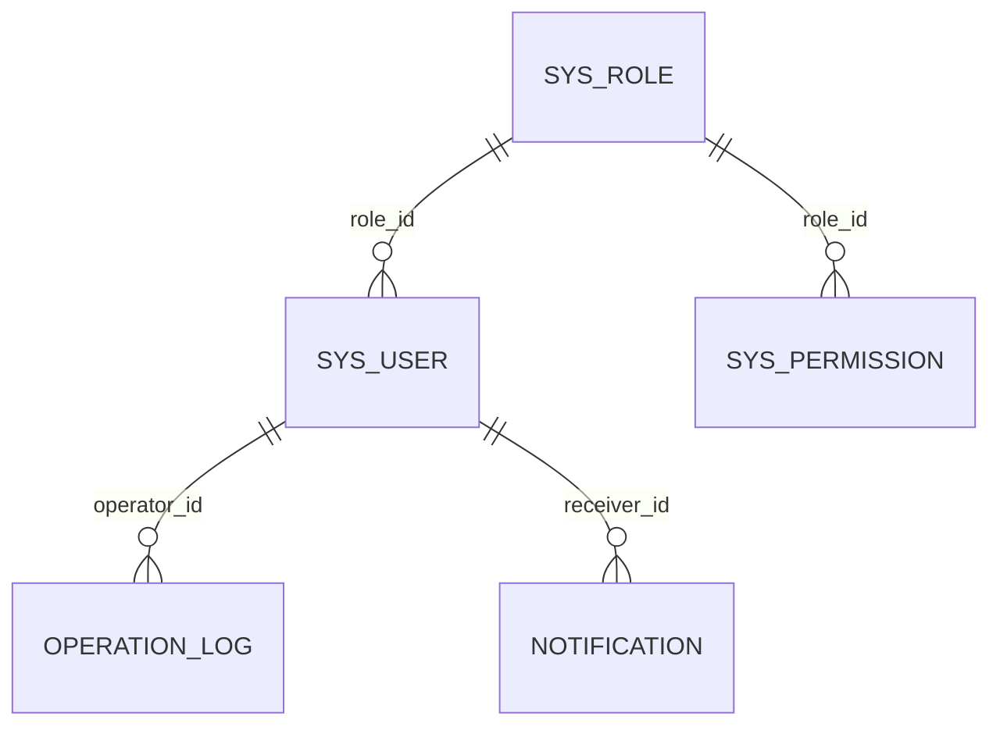

# 轻享图文 · 成员 A 开发文档

| 项目 | 内容 |
|---|---|
| 成员 | 成员 A（技术负责人） |
| 负责模块 | 账号、权限与治理 |
| 分支 | `feat/a-auth-rbac` |
| 文档版本 | v0.1（切片 1） |
| 最后更新 | 2026-11-18 |

---

## 1. 模块概述

- **负责范围**：注册 / 登录 / 退出、BCrypt 口令、session + CSRF、三角色 RBAC、Spring AOP 接口权限；后续切片补用户管理、操作日志、站内通知、个人资料。
- **不负责的范围**：文章 / 分类 / 审核（B）；点赞 / 收藏 / 评论 / 关注（C）；头像与正文图片落盘（B 的 `FileStorageService`）。
- **依赖的模块 / 契约**：切片 1 无上游依赖；B/C 依赖我提供的 `Result`、`LoginUser`、`CurrentUser`、`@RequirePermission`、`PermissionAspect`、`CsrfUtil`。
- **对外提供的接口 / 服务**：`/api/v1/auth/**`（注册、登录、退出、当前用户、刷新 CSRF）；`/login`、`/register`、`/me` 页面；`AuthService` / `UserService`。
- **对应产品文档章节**：《产品需求与业务说明书》第 2 章（角色与权限）、第 4 章（登录注册）；《开发规范》第 5 章（认证与权限）。

## 2. 需求分析

### 2.1 用例

| 编号 | 角色 | 场景 | 前置条件 | 结果 |
|---|---|---|---|---|
| UC-A-01 | 匿名 | 注册账号 | 用户名未被占用 | 建 `CREATOR` 账号，跳转登录 |
| UC-A-02 | 匿名 | 登录 | 账号存在、口令正确、状态正常 | 写 session，轮换 CSRF，进入账号页 |
| UC-A-03 | 登录用户 | 退出 | 已登录 | session 失效，回登录页 |
| UC-A-04 | 登录用户 | 访问 `/me` | 会话有效 | 展示昵称、角色、权限码 |
| UC-A-05 | 匿名 | 访问 `/me` | 未登录 | 页面 302 `/login`；`/api/**` 返回 401 JSON |
| UC-A-06 | 登录用户 | 提交写请求 | 没带 CSRF token | 403「页面已过期」 |
| UC-A-07 | 登录用户 | 会话版本失效 | 账号 `session_version` 变化 | 下一次请求被判定未登录 |

### 2.2 验收标准

- [x] 注册默认创作者；用户名唯一；口令 BCrypt 落库。
- [x] 登录成功返回用户、权限码、64 位十六进制 CSRF token。
- [x] 口令错误 401、账号停用 403、用户名重复 400，文案面向用户。
- [x] 页面未登录 302、API 未登录 401；写请求缺 token 403。
- [x] `session_version` 变化后旧会话立即失效（实测 401，重登后恢复）。
- [x] `mvn -B clean test` 全绿；主链路 curl 冒烟通过。

### 2.3 边界与不做

- 用户管理、角色分配、最后审核者保护在切片 2。
- 操作日志写入、站内通知写入在切片 2（本切片已建表）。
- 信息流 / 文章页由 B 提供；`/` 当前按登录态路由到 `/me` 或 `/login`。

## 3. 数据库设计

### 3.1 表清单

| 表 | 作用 | Owner | 迁移脚本 |
|---|---|---|---|
| `sys_role` | 三角色 | A | `sql/01_core.sql` |
| `sys_user` | 账号（单角色） | A | `sql/01_core.sql` |
| `sys_permission` | 角色权限码 | A | `sql/01_core.sql` |
| `operation_log` | 操作日志（切片 2 写入） | A | `sql/01_core.sql` |
| `notification` | 站内通知（切片 2 写入） | A | `sql/01_core.sql` |

### 3.2 字段与约束

| 字段 | 类型 | 约束 | 说明 |
|---|---|---|---|
| `sys_user.username` | VARCHAR(50) | UNIQUE | 登录名 |
| `sys_user.password` | VARCHAR(72) | NOT NULL | BCrypt cost 10 |
| `sys_user.role_id` | BIGINT | FK → `sys_role.id` | 单角色 |
| `sys_user.status` | TINYINT | NOT NULL | 1 正常 / 0 停用 |
| `sys_user.session_version` | INT | NOT NULL | 改密/改角色/封禁时 +1 |
| `sys_user.deleted` | TINYINT | NOT NULL | 显式过滤，不用 `@TableLogic` |

### 3.3 索引与外键

| 名称 | 类型 | 字段 | 用途 |
|---|---|---|---|
| `uk_username` | UNIQUE | `sys_user.username` | 注册重复兜底 |
| `uk_role_code` | UNIQUE | `sys_role.code` | 角色码唯一 |
| `uk_role_code` | UNIQUE | `sys_permission(role_id, code)` | 角色权限唯一 |
| `fk_user_role` | FK | `sys_user.role_id` | RESTRICT |
| `idx_notify_receiver` | INDEX | `notification(receiver_id, is_read, create_time)` | 未读数 |

### 3.4 状态 / 枚举

| 枚举 | 值 | 含义 |
|---|---|---|
| `roleCode` | `READER` / `CREATOR` / `REVIEWER` | 阅读者 / 创作者 / 审核者 |
| `user.status` | `ACTIVE` / `DISABLED` | 正常 / 停用 |
| 权限码 | `article:*`、`user:manage`、`log:view` 等 | 由 `sys_permission` 驱动 |

### 3.5 E-R 片段



## 4. 接口设计

### 4.1 接口清单

| 方法 | 路径 | 权限 | 说明 |
|---|---|---|---|
| POST | `/api/v1/auth/register` | 公开 | 注册，默认创作者 |
| POST | `/api/v1/auth/login` | 公开 | 登录，写 session |
| POST | `/api/v1/auth/logout` | 登录 + CSRF | 退出 |
| GET | `/api/v1/auth/me` | 登录 | 当前用户与权限 |
| GET | `/api/v1/auth/csrf` | 登录 | 刷新 CSRF token |

### 4.2 请求 / 响应

#### `POST /api/v1/auth/login`

请求：`{"username":"creator","password":"123456"}`

响应 `data`：

```json
{
  "user": {"id": 2, "username": "creator", "nickname": "创作者小享", "roleCode": "CREATOR", "roleName": "创作者", "status": "ACTIVE", "followerCount": 0, "followingCount": 0},
  "permissions": ["article:create", "article:delete", "article:submit", "article:update"],
  "csrfToken": "5a1ad0...986",
  "unreadCount": 0
}
```

错误：400（缺字段）、401（口令错误）、403（账号停用）。

#### `POST /api/v1/auth/register`

请求：`{"username":"a_smoke_2026","password":"123456","nickname":"A冒烟"}`

响应 `data`：`{"id":4,"username":"a_smoke_2026","nickname":"A冒烟","roleCode":"CREATOR"}`

错误：400（用户名被占用 / 校验失败）。

### 4.3 权限与归属

- 需要的权限码：本切片接口只区分「登录 / 未登录」；管理接口的权限码由 B/C 按模块标注 `@RequirePermission`。
- 资源归属校验：`AuthService.profile` 每次从库重读当前账号，避免会话里的角色与库脱节。
- 越权返回：页面 302、API 401；AOP 拦截到缺权限码时 403。

## 5. 后端实现

### 5.1 分层与类

| 层 | 类 / 文件 | 职责 |
|---|---|---|
| Controller | `controller/api/AuthController` | 认证 API |
| Controller | `controller/page/AuthPageController` | 登录 / 注册 / 退出 JSP 流程 |
| Controller | `controller/page/MePageController` | 账号中心页 |
| Service | `service/AuthService` | 注册、登录、当前用户 |
| Service | `service/UserService` | 账号 / 角色 / 权限查询、会话版本校验 |
| Mapper | `SysUserMapper` / `SysRoleMapper` / `SysPermissionMapper` / `NotificationMapper` | BaseMapper |
| DTO / VO | `LoginRequest`、`RegisterRequest`、`LoginUser`、`LoginResult`、`UserVO`、`LoginVO`、`RegisterVO` | 入参出参 |
| 拦截器 | `interceptor/LoginInterceptor`、`interceptor/CsrfInterceptor` | 登录态、CSRF |
| 切面 | `aspect/permission/PermissionAspect` | `@RequirePermission` 校验 |
| 工具 | `util/PasswordUtil`、`util/CsrfUtil`、`util/SessionUtil`、`util/CurrentUser` | BCrypt、token、会话收口 |

### 5.2 关键流程

```text
登录：参数校验 → 查账号（deleted=0）→ BCrypt 匹配 → status 校验 → 载入角色与权限
     → LoginUser 写 session（changeSessionId + 轮换 CSRF）→ 返回 LoginVO
访问受保护资源：LoginInterceptor 查 session → 回库核对 status/session_version
     → 失效则清 session → 页面 302 / API 401 → 权限切面再校验权限码
```

### 5.3 事务与并发

- 事务边界：`AuthService.register` 为 `@Transactional`；登录只读 + 不写库。
- 条件更新 / 乐观锁：本切片无状态流转；`session_version` 由后续改密 / 改角色 +1。
- 幂等 / 唯一键：`uk_username` 兜底并发注册；重复提交返回 400。
- 失败回滚：注册失败不落库；口令错误只记 401，不泄露账号是否存在。

### 5.4 异常与日志

- 业务异常码：400 / 401 / 403 / 404 / 409 / 500，统一 `BusinessException` → 双出口。
- 日志记录点：切面与拦截器不写业务日志；`operation_log` 写入在切片 2。
- 不记录的内容：口令、CSRF token、完整堆栈。

## 6. 前端实现

### 6.1 页面 / 组件

| 页面 | 路径 | 说明 |
|---|---|---|
| 登录 | `/login` | 胶囊输入、错误提示在表单上方 |
| 注册 | `/register` | 三项校验，失败保留输入 |
| 账号中心 | `/me` | 昵称 / 角色 / 粉丝关注 / 权限码 |
| 错误 | `/error` | 人话提示 + 返回首页 |

### 6.2 交互

- 加载 / 空态 / 错误态：错误用 `role="alert"`；权限为空时显示「阅读权限，无需管理权限码」。
- 表单校验：服务端 `@Valid` + 页面 BindingResult；失败保留已填用户名。
- 防抖 / 取消请求：M1 无前端 JS 请求。
- 响应式：560px 以下单列，头像与字号收缩。

### 6.3 UI 证据

- `docs/screenshots/auth/login-1280.png`
- `docs/screenshots/auth/register-1280.png`
- `docs/screenshots/auth/me-1280.png`
- `docs/screenshots/auth/me-390.png`

## 7. 测试

### 7.1 用例

| 编号 | 类型 | 场景 | 预期 | 结果 |
|---|---|---|---|---|
| T-01 | 单元 | BCrypt 编码与匹配 | 匹配、错口令拒绝 | PASS |
| T-02 | 单元 | 同口令不同盐 | 两次哈希不同 | PASS |
| T-03 | 单元 | 空值口令 | 不匹配 | PASS |
| T-04 | 单元 | CSRF 轮换 | 64 位 hex 且入 session | PASS |
| T-05 | 单元 | CSRF 保留 | `ensure` 复用旧 token | PASS |
| T-06 | 单元 | 连续轮换 | 两次 token 不同 | PASS |
| T-07 | 单元 | CSRF 校验 | 正确 / 错误 / 空 | PASS |
| T-08 | 单元 | 权限精确匹配 | 命中、未命中、null | PASS |
| T-09 | 单元 | 空权限集合 | 变成空集、无权限 | PASS |
| T-10 | 单元 | 权限集合不可变 | 外部不可改写 | PASS |
| T-11 | 单元 | 切面 401 | 匿名访问受保护方法 | PASS |
| T-12 | 单元 | 切面 403 | 已登录但无权限码 | PASS |
| T-13 | 单元 | 切面放行 | 有权限码并执行原方法 | PASS |
| T-14 | 单元 | 登录成功 | 返回角色、权限、session 版本 | PASS |
| T-15 | 单元 | 错误口令 | 401 | PASS |
| T-16 | 单元 | 停用账号 | 403 | PASS |
| T-17 | 单元 | 用户名重复 | 400 | PASS |
| T-18 | 单元 | 注册成功 | 建 CREATOR 账号 | PASS |
| T-19 | 手工 | 会话版本失效 | 旧会话 401，重登恢复 | PASS（curl 实测） |

### 7.2 测试结果

- `mvn -B clean test`：18 个用例全绿（`PermissionAspectTest` 3、`LoginUserTest` 3、`AuthServiceTest` 5、`CsrfUtilTest` 4、`PasswordUtilTest` 3）。
- 手工验证（curl，`http://127.0.0.1:18080/qingxiang`）：
  - 登录 200，返回 4 个权限码 + 64 位 token；
  - `/api/v1/auth/me` 带 Cookie 200、不带 401；
  - 退出缺 `X-CSRF-Token` 403、带 token 200，之后 `me` 401；
  - 注册 200、重复注册 400、错口令 401；
  - 页面 `/me` 未登录 302 `/login`，登录后 200 且渲染权限码；
  - `UPDATE sys_user SET session_version=1` 后旧会话 401，重登后 200。

### 7.3 发现的问题

| 问题 | 根因 | 修复 | 回归 |
|---|---|---|---|
| 登录后 302 地址带 `;jsessionid=` | 容器 URL rewriting | `web.xml` 设 `<tracking-mode>COOKIE</tracking-mode>` | 重新打包部署，重测表单登录 |
| cargo 打包时 `Java heap space` | war 打包内存不足 | `MAVEN_OPTS=-Xmx1024m` | 打包成功 |
| Windows curl 读不到 Cookie | jar 路径写成 `/c/tmp/...` | 用 `C:/...` 绝对路径 | 冒烟通过 |

## 8. 联调与契约

- 我调用谁：暂无（切片 1 只依赖自己的表）。
- 谁调用我：B/C 将调用登录态与 `@RequirePermission`；通知写入由 B/C 调 `NotificationService`（切片 2 提供）。
- 契约变更：`Result`、`LoginUser`、`@RequirePermission`、CSRF 头/字段按接口文档，无变更。
- 联调记录：2026-11-18，B/C 尚未开始；待 B 落地文章接口后联调「登录 → 发文章 → 审核」。

## 9. AI 使用记录

| 日期 | 用途 | AI 给了什么 | 我改了什么 | 如何验证 |
|---|---|---|---|---|
| 2026-11-18 | SSM 骨架与认证切片 | 三配置类、BCrypt、CSRF、登录拦截器、权限切面、SQL 与 JSP 初稿 | 调整会话版本校验路径、加 `tracking-mode`、补 `session_version` 实测、手工核对权限码顺序 | `mvn clean test` 18 绿 + curl 主链路 |

## 10. 增量记录

| 日期 | 增量 | 表 / 接口 / 页面 | 测试 | Commit |
|---|---|---|---|---|
| 2026-11-18 | 切片 1：登录 / 注册 / RBAC 骨架 | 5 张表；`/auth/**`；登录 / 注册 / `/me` 页面 | 18 个单元用例 + curl 冒烟 | 本分支提交 |

## 11. 自评与答辩

### 11.1 亮点

- `session_version` 每请求回库核对，改密 / 改角色可瞬间踢掉旧会话（有实测证据）。
- 权限切面放子容器 + `@RequirePermission`，并用单元测试证明 401 / 403 / 放行三条路径。
- 页面与 API 双出口分离：页面 302、API 401 JSON，错误码与 HTTP 状态一致。

### 11.2 不足与后续

- 无用户管理、操作日志写入、通知写入（切片 2）。
- AOP 尚未绑定到真实管理接口，等 B/C 接口落地后一起验。
- 会话版本每次请求查库，M1 可接受；数据量上来再加缓存。

### 11.3 5 分钟演示步骤

1. 打开 `/login`，用 `creator/123456` 登录，展示账号页与 4 个权限码。
2. 打开 `/me`，退出，再用错口令登录，展示 401 文案。
3. 用 curl 演示 `/api/v1/auth/me` 带 / 不带 Cookie 的 200 / 401。
4. 演示改 `session_version` 后旧会话立即 401。
5. 展示 `PermissionAspectTest` 覆盖的 401 / 403 / 放行。

## 12. 附录

- SQL：`sql/01_core.sql`、`sql/04_seed.sql`。
- curl：见 7.2；演示账号 `reviewer / creator / reader`，口令 `123456`。
- 截图：`docs/screenshots/auth/`。
- 相关文档：`docs/接口文档.md` 第 2 章、`docs/开发规范.md` 第 5 章。
