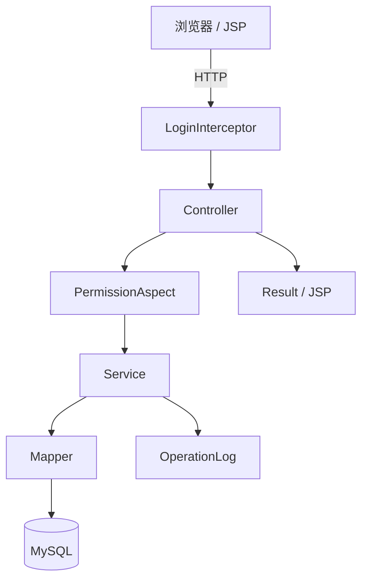
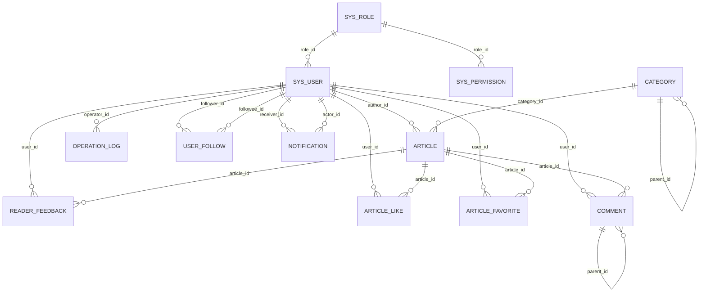

# 轻享图文 · 开发规范（M1）

> **项目名称说明**：本项目暂定名为「轻享图文」，名称后续可能调整；改名不影响本文档的技术约束。包名、context path、war 名暂以 `qingxiang` 作为代号。
>
> **工程基线**：`C:\Users\37549\Desktop\JFT1\大作业（作业2）\MonaHub`。复用其已验证的 SSM 全注解骨架、JSP 工程结构、测试与启动方式；**UI/UX 不再沿用 MonaHub**，改按 `docs/UIUX-小红书.md` 的小红书 Web 浅色设计 DNA。
>
> **课程依据**：《JAVA框架技术(一)》课程项目设计评分表（20 分）。M1 交付核心 CMS + 社交闭环；不做推荐算法、深色主题、风险分级。

| 项目 | 内容 |
|---|---|
| 文档版本 | v1.2（M1 + 社交闭环 + 浅色 + 自动封面） |
| 更新日期 | 2026-11-18 |
| 适用范围 | 后端、前端（JSP）、测试、部署、答辩 |
| 配套文档 | 《产品需求与业务说明书（M1）》《接口文档》《模块划分与分工》 |
| 冲突处理 | 业务规则以产品文档为准；技术实现以本文档为准 |

---

## 0. 评分表 → 本规范的落点

| 评分点 | 落点 |
|---|---|
| 需求分析文档（1） | 产品说明书 |
| 六表关联 / 主外键 / 索引（1.5） | 第 7 章 |
| 架构图 / E-R 图 / 业务流程图（1） | 第 3、7 章 + 产品文档第 3 章 |
| 企业级目录分层（0.5） | 第 3 章 |
| Spring AOP 接口权限（2） | 第 5 章 |
| 多级分类（1.5） | 第 8 章 |
| 文章 CRUD / 批量 / 分页 / 模糊检索 / 审核（1.5） | 第 6、8 章 |
| 日志 / 安全 / 统一异常 / 参数校验（1） | 第 5、10、11 章 |
| 分页高级查询 / 多维排序 / 逻辑删除 / 自动填充（1） | 第 7、8 章 |
| MyBatis-Plus 高级特性（1） | 第 7 章 |
| N+1 优化（1） | 第 7.5 节 |
| RESTful + 统一返回 + ApiFox（1） | 第 6 章 |
| 编码规范 / 分层 / 健壮性（3） | 全文 |
| AI 过程痕迹（2） | 第 13 章 |
| 结题报告 / 部署（1） | 第 12、13 章 |

---

## 1. 复用原则

### 1.1 从 MonaHub 直接复用的部分

| 能力 | MonaHub 落点 | 本项目的改动 |
|---|---|---|
| 容器初始化 | `config/ServletContainersInitConfig` | 包名、根/子配置类 |
| 父容器 | `config/SpringConfig` | 数据源、MP、事务、线程池 |
| 子容器 | `config/SpringMvcConfig` | 拦截器、校验器、视图、上传、权限切面 |
| 统一返回 | `dto/Result` | `code` 继续与 HTTP 状态一致 |
| 双异常出口 | `GlobalExceptionHandler` / `RestGlobalExceptionHandler` | 页面走 error.jsp，API 走 JSON |
| 登录拦截 | `interceptor/LoginInterceptor` | 增加角色/权限校验 |
| 存储服务 | `service/StorageService` | 头像/正文图片，不存 BLOB；封面自动生成，不走上传 |
| UI 设计系统 | `static/css/app.css` / `static/js/app.js` | **不沿用视觉**；只复用 JSP/JS 工程形态，样式按 `docs/UIUX-小红书.md` 重写 |
| 测试写法 | `ApiControllerTest` 等 | 换成 CMS 用例 |
| 启动脚本 | `start-monahub.bat` | 改 war 名、context、端口 |

### 1.2 必须新增、MonaHub 没有的部分

1. **六表 RBAC**：`sys_user` / `sys_role` / `sys_permission` / `article` / `category` / `operation_log`，外加 `reader_feedback` 与社交扩展表。
2. **Spring AOP 权限**：`@RequirePermission` + `PermissionAspect`，切 Controller 方法。
3. **文章状态机**：草稿 → 待审核 → 已发布 / 已驳回 / 已下架。
4. **审核工作台**：待审、通过、驳回、批量、下架。
5. **分类树**：多级、排序、启停、删除约束。
6. **用户管理**：审核者对用户增删改查、角色分配、最后审核者保护。
7. **社交闭环**：`article_like` / `article_favorite` / `comment` / `user_follow` / `notification`；点赞、收藏、评论/回复、关注/粉丝、站内通知。
8. **计数与通知**：文章点赞/收藏/评论数、用户粉丝/关注数；互动事件写入通知。

### 1.3 不要从 MonaHub 搬的部分

- 文件资料提交的业务语义、`file_info` / `download_log` 表结构。
- “上传即核心”的页面结构；本项目核心是图文、审核与社交互动。
- MonaHub 的 3 表模型；本项目必须落到六表 RBAC。

---

## 2. 技术基线

与 MonaHub 保持一致，避免“换项目就换一套依赖”。

| 层 | 选型 | 版本 |
|---|---|---|
| JDK | OpenJDK | **17**（MonaHub 基线） |
| Spring | IoC / MVC / JDBC / TX / AOP | 5.3.31 |
| 持久层 | MyBatis + XML | 3.5.15 / mybatis-spring 2.0.7 |
| MP | MyBatis-Plus（BaseMapper + 分页 + 乐观锁） | 3.5.5 |
| 分页依赖 | jsqlparser | 4.6 |
| 口令 | Spring Security Crypto · BCrypt | 5.7.11 |
| 连接池 | HikariCP | 4.0.3 |
| 数据库 | MySQL | 8.0.33 驱动 / 本机 9.3 |
| JSON | Jackson + jsr310 | 2.15.4 |
| AOP | AspectJ Weaver | 1.9.22 |
| 校验 | Hibernate Validator（javax 栈） | 6.2.5.Final |
| EL | tomcat-embed-el（provided） | 9.0.83 |
| 视图 | JSP + JSTL | servlet-api 4.0.1 / jstl 1.2 |
| 上传 | commons-fileupload / commons-io | 1.5 / 2.20.0 |
| 日志 | SLF4J + Log4j 1.2 | 1.7.36 / 1.2.17 |
| 测试 | JUnit 5 + Spring Test | 5.11.0 / 5.3.31 |
| 构建 | Maven war | 3.9.x |
| 容器 | Tomcat | **9.0.86**（不能用 10+，jakarta 不兼容） |
| 前端 | JSP + JSTL + 原生 CSS/JS + 本地 GSAP | — |

**明确不用**：Spring Boot、Spring Security 过滤器链、Redis（M1）、定时任务（M1）、Vue/Node 构建（M1 默认 JSP）。

> **JDK 版本**：MonaHub 用 17，本规范跟 17。若指导老师坚持 JDK 8，把 `maven.compiler.release` 改为 8，并避免 `var`、`record`、`switch` 表达式、文本块；其余依赖版本不变。

---

## 3. 工程结构

```text
qingxiang-tuwen/
├─ pom.xml
├─ start-qingxiang.bat
├─ sql/
│  ├─ 01_schema.sql              # 六表 + reader_feedback + 社交扩展表 + 外键/索引
│  ├─ 02_data.sql                # 角色/权限/演示账号/分类/示例内容（BCrypt 哈希）
│  └─ 01_core / 02_content / 03_social.sql  # 可选：按模块拆分的初始化脚本
├─ docs/
│  ├─ 产品需求与业务说明书.md
│  ├─ 开发规范.md
│  ├─ 接口文档.md
│  ├─ 模块划分与分工.md
│  ├─ UIUX-小红书.md
│  ├─ screenshots/xiaohongshu/
│  ├─ apifox/qingxiang-api.postman_collection.json
│  └─ ai/                        # AI 交互记录、关键 diff、截图
├─ src/main/java/com/qingxiang/
│  ├─ config/
│  │  ├─ ServletContainersInitConfig.java
│  │  ├─ SpringConfig.java
│  │  └─ SpringMvcConfig.java
│  ├─ controller/
│  │  ├─ page/                   # 返回 JSP 视图
│  │  └─ api/                    # 返回 Result<T>
│  ├─ service/                   # 业务规则、事务边界
│  ├─ mapper/                    # MyBatis 接口
│  ├─ entity/                    # 表映射
│  ├─ dto/                       # 入参
│  ├─ vo/                        # 出参（含 join 字段）
│  ├─ aspect/
│  │  ├─ log/                    # 请求日志（父容器）
│  │  └─ permission/             # 权限切面（子容器）
│  ├─ interceptor/LoginInterceptor.java
│  ├─ exception/                 # BusinessException + 双异常出口
│  └─ util/                      # PasswordUtil、CsrfUtil、IpUtil
├─ src/main/resources/
│  ├─ mapper/*.xml               # 复杂 SQL / 分页 / join
│  ├─ common/db.properties       # gitignored
│  └─ common/app.properties      # 上传目录、大小、白名单
├─ src/main/webapp/
│  ├─ WEB-INF/web.xml            # 薄化：error-page / session-config
│  ├─ WEB-INF/views/             # login/register/home/detail/creator/admin/social/notification/error
│  └─ static/{css,js,vendor/gsap.min.js}
└─ src/test/java/com/qingxiang/  # MockMvc + 服务测试
```

**context path**：`/qingxiang`；**端口**：`18080`（8080 被 xerj 占用）；war 名 `qingxiang.war`。

### 3.1 架构图



### 3.2 分层规则

- `Controller`：参数绑定、`@Valid`、调用 Service、返回视图或 `Result`；不写业务判断，不直接调 Mapper。
- `Service`：业务规则、权限归属复核、事务边界；一个业务动作一个方法。
- `Mapper`：只做数据访问；复杂 SQL 写 XML；禁止在注解里堆长 SQL。
- `Entity` 不直接返回给页面/API；出参用 `VO`，入参用 `DTO`。
- `aspect/log` 放父容器（切 Service），`aspect/permission` 放子容器（切 Controller）——切错容器 = 切面静默失效。

---

## 4. 容器与配置

### 4.1 三个配置类（全注解，照 MonaHub）

**`ServletContainersInitConfig`**（取代 web.xml 的 listener/servlet/filter）：

- 根容器：`SpringConfig.class`
- 子容器：`SpringMvcConfig.class`
- 映射：`"/"`
- 编码过滤器：`setForceRequestEncoding(true)`、`setForceResponseEncoding(false)`；否则下载/JSON 响应会被追加 `;charset=UTF-8`。

**`SpringConfig`**（父容器）：

```java
@Configuration
@PropertySource({"classpath:common/db.properties", "classpath:common/app.properties"})
@ComponentScan({"com.qingxiang.service", "com.qingxiang.aspect.log"})
@EnableAspectJAutoProxy
@EnableTransactionManagement
@MapperScan("com.qingxiang.mapper")
public class SpringConfig { ... }
```

- Hikari：参数全部来自 `db.properties`，禁止硬编码；`maximumPoolSize=10`。
- `SqlSessionFactoryBean`：
  - **必须** `factory.setConfiguration(new MybatisConfiguration())`，否则 BaseMapper 语句不注入，运行期 `Invalid bound statement`。
  - `setMapperLocations("classpath:mapper/*.xml")`
  - `setTypeAliasesPackage("com.qingxiang.entity")`
  - `setPlugins(mybatisPlusInterceptor)`
- MP 拦截器：`PaginationInnerInterceptor(maxLimit=100)` + `OptimisticLockerInnerInterceptor`。
- 事务：`DataSourceTransactionManager`。
- 线程池：只有上传需要时加；核心 2 / 最大 8 / 队列 32 / `CallerRunsPolicy`。

**`SpringMvcConfig`**（子容器）：

```java
@Configuration
@EnableWebMvc
@EnableAspectJAutoProxy
@ComponentScan({"com.qingxiang.controller", "com.qingxiang.interceptor",
        "com.qingxiang.exception"})
public class SpringMvcConfig implements WebMvcConfigurer { ... }
```

- 拦截器：`addPathPatterns("/**")`，放行 `/login`、`/register`、`/static/**`、`/error`、`/favicon.ico`。
- **显式** `getValidator()` 返回 `LocalValidatorFactoryBean`；否则纯 Spring 下 `@Valid` 静默失效。
- Jackson 关闭 `WRITE_DATES_AS_TIMESTAMPS`，API 输出 ISO-8601。
- 静态资源 `setCacheControl(CacheControl.noCache())`；否则前端改动后浏览器吃旧 CSS/JS。
- 子容器 `@Value` 读不到父容器 `@PropertySource` 的属性（MonaHub 实测）；上传限值等配置在 `SpringMvcConfig` 里用字面量并手动同步，或由父容器提供配置 Bean，不要指望子容器直接注入 `app.properties`。
- 视图解析器：`/WEB-INF/views/` + `.jsp`。
- `multipartResolver`：Bean 名必须是 `multipartResolver`；单文件 5MB、总量 20MB、`resolveLazily=true`。
- **`PermissionAspect` 用 `@Bean` 注册在子容器**，不要让父容器 `component-scan` 扫到；它切 Controller，必须在子容器才能代理。

**`web.xml`**：只留 `error-page 404/500 → /error` 和 `session-config`（30 分钟）。

### 4.2 扫描边界（避免重复 Bean / 双重代理）

| 包 | 容器 | 原因 |
|---|---|---|
| `service` | 父 | 数据源/事务 |
| `aspect.log` | 父 | 切 Service |
| `controller` | 子 | MVC |
| `interceptor` | 子 | MVC |
| `exception` | 子 | `@ControllerAdvice` |
| `aspect.permission` | 子（`@Bean`） | 切 Controller |
| `config` | 不扫描 | 由初始化类显式加载 |

### 4.3 CORS

- 只对 `/api/**` 开；允许来源写死为 `http://127.0.0.1:18080`、`http://localhost:18080`。
- 不允许 `allowedOriginPatterns("*") + allowCredentials(true)` 组合；生产/演示都不这么写。
- JSP 页面同源，不需要 CORS。

---

## 5. 认证与权限

### 5.1 六表 RBAC 模型

| 表 | 作用 | 关键关系 |
|---|---|---|
| `sys_user` | 账号 | `role_id → sys_role.id` |
| `sys_role` | 角色 | 阅读者 / 创作者 / 审核者 |
| `sys_permission` | 角色权限 | `role_id → sys_role.id`，`code` 唯一 |
| `article` | 图文 | `author_id → sys_user.id`，`category_id → category.id` |
| `category` | 分类树 | `parent_id → category.id` |
| `operation_log` | 操作日志 | `operator_id → sys_user.id` |
| `reader_feedback`（扩展） | 减少推荐 | `user_id`、`article_id` |
| `article_like`（扩展） | 点赞 | `user_id`、`article_id` |
| `article_favorite`（扩展） | 收藏 | `user_id`、`article_id` |
| `comment`（扩展） | 评论/回复 | `article_id`、`user_id`、`parent_id` |
| `user_follow`（扩展） | 关注 | `follower_id`、`followee_id` |
| `notification`（扩展） | 站内通知 | `receiver_id`、`actor_id` |

M1 采用**用户单角色**模型：`sys_user.role_id`，角色直连权限。这样六张核心表保持完整；社交表是扩展，不改变六表考核口径。若后续需要一人多角色，M2 再加 `sys_user_role` 关系表。

### 5.2 角色与权限码

| 角色 code | 名称 | 权限 |
|---|---|---|
| `READER` | 阅读者 | 浏览、搜索、点赞/收藏、评论/回复、关注、通知、减少推荐（登录即可，无需管理权限） |
| `CREATOR` | 创作者 | 阅读者全部能力 + `article:create`、`article:update`、`article:delete`、`article:submit` |
| `REVIEWER` | 审核者 | 阅读者全部能力 + `article:review`、`article:unpublish`、`article:batch`、`comment:manage`、`category:manage`、`user:manage`、`log:view` |

权限码表：

| code | 说明 |
|---|---|
| `article:create` | 新建内容 |
| `article:update` | 编辑自己的内容 |
| `article:delete` | 删除自己的内容 |
| `article:submit` | 提交审核 / 撤回 |
| `article:review` | 通过 / 驳回 |
| `article:unpublish` | 下架 / 重新上架 |
| `article:batch` | 批量通过/驳回/下架/删除 |
| `comment:manage` | 评论治理（隐藏/删除任意评论） |
| `category:manage` | 分类增删改、排序、启停 |
| `user:manage` | 用户增删改查、角色分配 |
| `log:view` | 查看操作日志 |

### 5.3 登录态

- 登录成功后 `request.changeSessionId()` 防会话固定；`session.setAttribute("loginUser", user)`。
- `LoginUser` 存：`id`、`username`、`nickname`、`roleCode`、`roleId`、`sessionVersion`、`permissions`（Set<String>）。
- `sys_user.session_version`：登录时写入会话；`LoginInterceptor` 每次请求校验 `status=1` 且 `session_version` 一致；不一致/停用 → 清 session，页面 302、API 401。封禁、改密、改角色时 `session_version + 1`，旧会话立即失效。
- `LoginInterceptor` 需要查 `session_version`，不能在 `addInterceptors` 里 `new`；在 `SpringMvcConfig` 用 `@Bean` 注入 `UserService` 后再注册。放行清单要包含 `/api/v1/auth/login`、`/api/v1/auth/register`。
- 退出 `session.invalidate()`。
- `LoginInterceptor`：
  - 页面请求未登录 → 302 `/login`。
  - `/api/**` 未登录 → HTTP 401 + `Result.fail(401, "未登录")` JSON。
  - 放行路径只在 `SpringMvcConfig#addInterceptors` 声明。
- 口令：`PasswordUtil.encode/matches`，BCrypt cost 10；库里不存明文；日志/响应不出现口令。
- 种子账号哈希放 `02_data.sql`；生成命令：`python -c "import bcrypt; print(bcrypt.hashpw(b'123456', bcrypt.gensalt(10, prefix=b'2a')).decode())"`。
- 若指导书要求 `salt` 字段：保留 `salt VARCHAR(32) DEFAULT ''` 兼容，代码不依赖；BCrypt 自带盐。

### 5.4 Spring AOP 权限校验（评分点 2 分）

**注解**：

```java
@Target(ElementType.METHOD)
@Retention(RetentionPolicy.RUNTIME)
public @interface RequirePermission {
    String value();
}
```

**切面**（放 `com.qingxiang.aspect.permission`，在子容器 `@Bean` 注册）：

```java
@Aspect
public class PermissionAspect {
    @Around("@annotation(perm)")
    public Object check(ProceedingJoinPoint pjp, RequirePermission perm) throws Throwable {
        LoginUser user = CurrentUser.get();
        if (user == null) {
            throw new BusinessException(401, "未登录");
        }
        if (!user.hasPermission(perm.value())) {
            throw new BusinessException(403, "无权限执行该操作");
        }
        return pjp.proceed();
    }
}
```

**用法**：

```java
@RequirePermission("article:review")
@PostMapping("/api/v1/reviews/{id}/approve")
public Result<Void> approve(@PathVariable Long id) { ... }
```

规则：

- 拦截器负责“有没有登录”，切面负责“有没有权限”；两者都做，不能只靠前端隐藏按钮。
- Controller 上只标权限码；**资源归属**（作者只能改自己的内容、审核者不能审自己的内容）在 Service 再做一次。
- 切面抛 `BusinessException(401/403)`；API 由 `RestGlobalExceptionHandler` 转 `Result`，页面由 `GlobalExceptionHandler` 转 `error.jsp`。
- 没有权限时不要返回“资源不存在”以外的模糊信息；403 就明确 403。
- `CurrentUser` 从 `RequestContextHolder` 取当前请求的 `HttpSession`，再读 `loginUser`；不要依赖 `SecurityContextHolder`（本项目不引入 Spring Security 过滤器链）。

### 5.5 用户与角色保护

- 审核者可以新增/编辑/停用/删除用户、调整角色；所有变更写操作日志。
- 不能删除自己；不能删除、停用、降级**最后一名审核者**。
- 审核者不参与创作（M1 默认）；若后续允许，审核自己的内容必须被拒绝。
- 角色变更后 `session_version + 1`，目标用户下一次请求被判定会话失效，需重新登录后按新权限生效；避免旧权限集合继续生效。封禁、改密同理。

### 5.6 CSRF（会话登录必须做）

- 登录后生成随机 token 存 session；JSP 表单放隐藏域 `_csrf`，fetch 请求放 `X-CSRF-Token`。
- `CsrfInterceptor` 对 `POST/PUT/DELETE` 校验；`/api/v1/auth/login`、`/register` 可放行（登录前无会话）。
- 失败返回 403 + “页面已过期，请刷新后重试”。
- 不使用 Cookie 存 JWT，避免 CSRF 与 XSS 的取舍；M1 用 session。

---

## 6. 接口规范

### 6.1 基础

- 前缀 `/api/v1`；资源名复数、kebab-case；页面控制器与 API 控制器分包。
- `GET` 查询、`POST` 创建/动作、`PUT` 更新、`DELETE` 删除。
- 请求/响应 `application/json; charset=UTF-8`；上传 `multipart/form-data`。
- 业务动作允许子路径：`POST /api/v1/articles/{id}/submit`、`POST /api/v1/reviews/{id}/approve`。

### 6.2 统一返回（照 MonaHub，`code` = HTTP 状态）

```json
{ "code": 200, "message": "success", "data": { } }
{ "code": 409, "message": "该内容已被处理", "data": null }
```

- `code` 与 HTTP 状态码一致：200 / 400 / 401 / 403 / 404 / 409 / 500。
- 成功无数据时 `data` 为 `null`；列表用 `PageResult<T>`。
- 角色、文章状态、审核动作、通知类型在 API 用字符串枚举；数据库存 `TINYINT`，由后端枚举转换，前端不要依赖数字。
- 错误信息给用户看中文，不含堆栈、SQL、类名。
- 双异常出口：
  - 页面：`@ControllerAdvice` → `error.jsp`。
  - API：`@RestControllerAdvice(basePackages = "com.qingxiang.controller.api")` → `Result` JSON。
- 参数校验失败：400 + 字段级消息（`@Valid` + `BindingResult` / 全局处理）。

### 6.3 分页

- 请求：`page`（从 1 开始，默认 1）、`size`（默认 10，最大 50）。
- 响应：

```json
{ "code": 200, "data": { "list": [], "total": 128, "page": 1, "size": 10 } }
```

- `PageResult<T>` 统一封装；Service 把 `size` 夹紧到 1–50。
- 排序字段白名单：`publish_time`、`create_time`、`update_time`、`title`；方向只允许 `asc/desc`；禁止把前端字段名直接拼进 SQL。
- XML 分页 SQL **不写 `LIMIT`**；由 MP 分页插件追加 LIMIT 与 count。

### 6.4 核心接口

| 方法 | 路径 | 权限 | 说明 |
|---|---|---|---|
| POST | `/api/v1/auth/register` | 公开 | 注册，默认创作者 |
| POST | `/api/v1/auth/login` | 公开 | 登录，写 session |
| POST | `/api/v1/auth/logout` | 登录 | 退出 |
| GET | `/api/v1/auth/me` | 登录 | 当前用户与权限 |
| GET | `/api/v1/auth/csrf` | 登录 | 刷新 CSRF token |
| GET | `/api/v1/articles` | 公开 | 信息流/搜索：keyword、categoryId、page、size、sort |
| GET | `/api/v1/articles/following` | 登录 | 关注流：只出已关注作者的已发布内容 |
| GET | `/api/v1/articles/{id}` | 公开 | 详情；非公开仅作者/审核者可看 |
| POST | `/api/v1/articles` | `article:create` | 新建草稿 |
| PUT | `/api/v1/articles/{id}` | `article:update` | 编辑；已发布保存后回待审核 |
| DELETE | `/api/v1/articles/{id}` | `article:delete` | 删除自己的内容（逻辑） |
| POST | `/api/v1/articles/{id}/submit` | `article:submit` | 提交审核 |
| POST | `/api/v1/articles/{id}/withdraw` | `article:submit` | 撤回为草稿 |
| GET | `/api/v1/categories/tree` | 公开 | 启用分类树 |
| POST/PUT/DELETE | `/api/v1/admin/categories/**` | `category:manage` | 分类增删改、排序、启停 |
| GET | `/api/v1/reviews` | `article:review` | 待审列表 |
| GET | `/api/v1/reviews/{id}` | `article:review` | 审核详情 + 历史记录 |
| POST | `/api/v1/reviews/{id}/approve` | `article:review` | 通过 |
| POST | `/api/v1/reviews/{id}/reject` | `article:review` | 驳回，理由必填 |
| POST | `/api/v1/reviews/batch` | `article:batch` | 批量通过/驳回/下架/删除 |
| POST | `/api/v1/admin/articles/{id}/unpublish` | `article:unpublish` | 下架 |
| POST | `/api/v1/admin/articles/{id}/republish` | `article:unpublish` | 重新上架 |
| GET | `/api/v1/admin/users` | `user:manage` | 用户列表/搜索 |
| POST/PUT/DELETE | `/api/v1/admin/users/**` | `user:manage` | 用户增删改、角色、状态 |
| GET | `/api/v1/admin/logs` | `log:view` | 日志筛选/分页 |
| POST | `/api/v1/feedback` | 登录 | 减少推荐 |
| DELETE | `/api/v1/feedback/{articleId}` | 登录 | 恢复推荐 |
| POST | `/api/v1/files/avatar` | 登录 | 头像上传 |
| GET | `/api/v1/me/articles` | 登录 | 我的内容：按状态筛选/分页 |
| PUT / DELETE | `/api/v1/articles/{id}/like` | 登录 | 点赞 / 取消点赞 |
| PUT / DELETE | `/api/v1/articles/{id}/favorite` | 登录 | 收藏 / 取消收藏 |
| GET | `/api/v1/me/favorites` | 登录 | 我的收藏 |
| GET | `/api/v1/articles/{id}/comments` | 公开 | 评论列表（一级 + 回复） |
| POST | `/api/v1/articles/{id}/comments` | 登录 | 发表评论/回复 |
| DELETE | `/api/v1/comments/{id}` | 登录 | 删除评论（作者/文章作者/审核者） |
| GET | `/api/v1/admin/comments` | `comment:manage` | 评论治理列表 |
| PUT | `/api/v1/admin/comments/{id}/status` | `comment:manage` | 隐藏/恢复评论 |
| PUT / DELETE | `/api/v1/users/{id}/follow` | 登录 | 关注 / 取关 |
| GET | `/api/v1/users/{id}/followers` | 公开 | 粉丝列表 |
| GET | `/api/v1/users/{id}/following` | 公开 | 关注列表 |
| GET | `/api/v1/users/{id}` | 公开 | 作者主页 |
| GET | `/api/v1/users/{id}/articles` | 公开 | 作者已发布内容 |
| GET | `/api/v1/notifications` | 登录 | 通知列表 |
| GET | `/api/v1/notifications/unread-count` | 登录 | 未读数 |
| PUT | `/api/v1/notifications/{id}/read` | 登录 | 单条已读 |
| PUT | `/api/v1/notifications/read-all` | 登录 | 全部已读 |
| PUT | `/api/v1/me/profile` | 登录 | 修改昵称/头像/简介 |
| PUT | `/api/v1/me/password` | 登录 | 修改密码 |

### 6.5 ApiFox 与接口文档

- 接口单一来源：`docs/接口文档.md`；ApiFox 集合按本文档生成，路径 `docs/apifox/qingxiang-api.postman_collection.json`（Postman v2.1，ApiFox 可直接导入）。
- 用例至少覆盖：注册/登录/401/403、文章 CRUD、提交/通过/驳回/并发 409、批量部分成功、分类删除约束、用户最后审核者保护、搜索只出已发布、减少推荐幂等、点赞/收藏幂等、评论/回复与删除权限、关注/关注流、通知未读/已读、日志筛选。
- 接口变更必须同步集合与本文档；只改代码不改文档视为未完成。
- 若额外接 springdoc：只能用 1.7.x（javax 栈），并在 Tomcat 9 实测；不强制。

---

## 7. 数据规范

### 7.1 E-R 图



六张核心表：`sys_user`、`sys_role`、`sys_permission`、`article`、`category`、`operation_log`。`reader_feedback`、`article_like`、`article_favorite`、`comment`、`user_follow`、`notification` 是社交扩展表，不计入六表考核。

### 7.2 建表约定

- MySQL 5.7+ 兼容，`utf8mb4` / `utf8mb4_general_ci`，`InnoDB`。
- 主键 `BIGINT AUTO_INCREMENT`；`@TableId(type = IdType.AUTO)`。
- 时间列：`create_time`、`update_time` `DATETIME NOT NULL`；用 MP `MetaObjectHandler` 自动填充。
- 逻辑删除：`deleted TINYINT NOT NULL DEFAULT 0`；所有查询显式 `deleted = 0`。
- **不使用 `@TableLogic`**：自定义 XML 与 BaseMapper 的过滤行为不一致，容易漏过滤；MonaHub 同样采用显式 `deleted` 条件。若老师明确要求 MP 逻辑删除注解，再统一评估。
- 外键：按评分表要求建物理外键；删除策略 `ON DELETE RESTRICT`，不做级联删除（业务先校验）。
- 字段约束：`NOT NULL` + 默认值；状态用 `TINYINT` + 注释；`CHECK` 约束可选（MySQL 8.0.16+ 生效，5.7 忽略）。
- 禁止 BLOB 存图片；只存 URL/相对路径。

### 7.3 表字段

**sys_user**

| 字段 | 类型 | 说明 |
|---|---|---|
| id | BIGINT PK | 主键 |
| username | VARCHAR(50) | 登录名，唯一 |
| password | VARCHAR(72) | BCrypt 哈希 |
| salt | VARCHAR(32) | 兼容位，默认空串；BCrypt 自带盐 |
| nickname | VARCHAR(50) | 展示名 |
| avatar_url | VARCHAR(512) | 头像，可空 |
| bio | VARCHAR(200) | 简介，可空 |
| follower_count | INT UNSIGNED | 粉丝数冗余，默认 0 |
| following_count | INT UNSIGNED | 关注数冗余，默认 0 |
| role_id | BIGINT FK | 角色 |
| status | TINYINT | 1 正常 / 0 停用 |
| session_version | INT | 会话版本；封禁/改密/改角色时 +1，旧会话失效 |
| create_time / update_time | DATETIME | — |
| deleted | TINYINT | 0 / 1 |

**sys_role**

| 字段 | 类型 | 说明 |
|---|---|---|
| id | BIGINT PK | — |
| code | VARCHAR(20) | READER / CREATOR / REVIEWER，唯一 |
| name | VARCHAR(50) | 阅读者 / 创作者 / 审核者 |
| description | VARCHAR(200) | 说明 |
| create_time | DATETIME | — |

**sys_permission**

| 字段 | 类型 | 说明 |
|---|---|---|
| id | BIGINT PK | — |
| role_id | BIGINT FK | 角色 |
| code | VARCHAR(50) | 权限码 |
| name | VARCHAR(50) | 说明 |
| create_time | DATETIME | — |

唯一键 `uk_role_code(role_id, code)`。

**article**

| 字段 | 类型 | 说明 |
|---|---|---|
| id | BIGINT PK | — |
| author_id | BIGINT FK | 作者 |
| category_id | BIGINT FK | 末级分类 |
| title | VARCHAR(120) | 标题 |
| cover_color | CHAR(7) | 自动封面纯色背景，如 `#15803d`；服务端从预设色板选 |
| content | MEDIUMTEXT | 净化后的 HTML |
| status | TINYINT | 0 草稿 / 1 待审核 / 2 已发布 / 3 已驳回 / 4 已下架 |
| reject_reason | VARCHAR(500) | 驳回/下架理由 |
| reviewer_id | BIGINT FK | 审核人，可空 |
| review_time | DATETIME | 审核时间，可空 |
| publish_time | DATETIME | 首次发布时间，可空 |
| like_count | INT UNSIGNED | 点赞数冗余，默认 0 |
| favorite_count | INT UNSIGNED | 收藏数冗余，默认 0 |
| comment_count | INT UNSIGNED | 可见评论数冗余，默认 0 |
| create_time / update_time | DATETIME | — |
| deleted | TINYINT | 0 / 1 |
| version | INT | 乐观锁 |

索引：

- `idx_feed(status, publish_time, id)`：信息流。
- `idx_category(category_id, status, publish_time, id)`：分类筛选。
- `idx_author(author_id, status, update_time)`：我的内容。
- `idx_review(status, create_time, id)`：待审队列。
- `idx_reviewer(reviewer_id, review_time)`：审核记录。

**category**

| 字段 | 类型 | 说明 |
|---|---|---|
| id | BIGINT PK | — |
| parent_id | BIGINT FK | 根为 0 |
| name | VARCHAR(50) | 分类名 |
| level | TINYINT | 层级，从 1 开始 |
| path | VARCHAR(255) | 物化路径，如 `/1/5/9/` |
| sort | INT | 同级排序 |
| status | TINYINT | 1 启用 / 0 停用 |
| create_time / update_time | DATETIME | — |
| deleted | TINYINT | 0 / 1 |

索引：`idx_parent_sort(parent_id, sort)`、`idx_path(path)`。`path` 用于父分类聚合子分类内容；最大层级 5，运营建议 3。

**operation_log**

| 字段 | 类型 | 说明 |
|---|---|---|
| id | BIGINT PK | — |
| operator_id | BIGINT FK | 操作人 |
| action | VARCHAR(50) | 如 `ARTICLE_APPROVE`、`USER_ROLE` |
| target_type | VARCHAR(20) | ARTICLE / USER / CATEGORY / COMMENT |
| target_id | BIGINT | 对象 ID |
| result | VARCHAR(10) | SUCCESS / FAIL |
| reason | VARCHAR(500) | 理由 |
| detail | VARCHAR(2000) | 变更摘要 JSON |
| ip | VARCHAR(45) | 来源 IP |
| create_time | DATETIME | — |

索引：`idx_operator_time(operator_id, create_time)`、`idx_target(target_type, target_id)`、`idx_create_time(create_time)`。只追加，不提供修改/删除接口。

**reader_feedback**（扩展）

| 字段 | 类型 | 说明 |
|---|---|---|
| id | BIGINT PK | — |
| user_id | BIGINT FK | 阅读者 |
| article_id | BIGINT FK | 内容 |
| create_time | DATETIME | — |

唯一键 `uk_user_article(user_id, article_id)`；重复提交幂等。

**article_like / article_favorite**（扩展）

| 字段 | 类型 | 说明 |
|---|---|---|
| id | BIGINT PK | — |
| user_id | BIGINT FK | 用户 |
| article_id | BIGINT FK | 文章 |
| create_time | DATETIME | — |

唯一键 `uk_like(user_id, article_id)`、`uk_favorite(user_id, article_id)`；索引 `idx_like_article(article_id)`、`idx_favorite_article(article_id)`。取消点赞/收藏直接物理删除行；计数原子回退。

**comment**（扩展）

| 字段 | 类型 | 说明 |
|---|---|---|
| id | BIGINT PK | — |
| article_id | BIGINT FK | 文章 |
| user_id | BIGINT FK | 评论人 |
| parent_id | BIGINT | 0 表示一级评论；否则为一级评论 id |
| content | VARCHAR(1000) | 评论正文 |
| status | TINYINT | 1 可见 / 0 已隐藏 |
| deleted | TINYINT | 0 / 1 |
| create_time / update_time | DATETIME | — |

索引：`idx_comment_article(article_id, status, create_time)`、`idx_comment_parent(parent_id, create_time)`、`idx_comment_user(user_id)`。只允许一层回复：`parent_id` 必须指向 `parent_id=0` 的评论；Service 校验。

**user_follow**（扩展）

| 字段 | 类型 | 说明 |
|---|---|---|
| id | BIGINT PK | — |
| follower_id | BIGINT FK | 关注者 |
| followee_id | BIGINT FK | 被关注者 |
| create_time | DATETIME | — |

唯一键 `uk_follow(follower_id, followee_id)`；索引 `idx_followee(followee_id)`。取关物理删除；不能关注自己。

**notification**（扩展）

| 字段 | 类型 | 说明 |
|---|---|---|
| id | BIGINT PK | — |
| receiver_id | BIGINT FK | 接收者 |
| actor_id | BIGINT FK | 触发者；系统通知可空 |
| type | VARCHAR(30) | ARTICLE_APPROVED / ARTICLE_REJECTED / ARTICLE_UNPUBLISHED / COMMENT / REPLY / LIKE / FAVORITE / FOLLOW |
| target_type | VARCHAR(20) | ARTICLE / COMMENT / USER |
| target_id | BIGINT | 目标 ID |
| content | VARCHAR(300) | 摘要文案 |
| is_read | TINYINT | 0 未读 / 1 已读 |
| create_time | DATETIME | — |

索引：`idx_notify_receiver(receiver_id, is_read, create_time)`、`idx_notify_target(target_type, target_id)`。不做逻辑删除；已读只改 `is_read`。

### 7.4 MyBatis-Plus 用法

- `BaseMapper` 负责：单表 insert、按 id 查询、条件构造器单行读。
- 复杂 SQL（分页 join、模糊搜索、批量状态更新、日志筛选）写 `mapper/*.xml`。
- 分页方法命名 `selectPageQuery`，不要与 BaseMapper 的 `selectPage` 同名，避免 Mapped Statements 冲突。
- 分页三件套缺一即静默全量：`MybatisPlusInterceptor` + `PaginationInnerInterceptor` + `jsqlparser`；XML 不写 `LIMIT`。
- 自动填充：`MetaObjectHandler` 填 `createTime`/`updateTime`；`@TableField(fill = ...)`。
- 乐观锁：`article.version` + `@Version` + `OptimisticLockerInnerInterceptor`；状态流转仍用条件更新。
- 批量：不要用 `foreach` 拼超长 `IN`；单批 ≤ 200，分批执行。

### 7.5 N+1 优化（评分点）

- 文章列表必须一次 join 出作者昵称、分类名，禁止每行再查一次：

```sql
SELECT a.id, a.title, a.cover_color, a.status, a.publish_time,
       u.nickname AS author_name, c.name AS category_name
FROM article a
JOIN sys_user u ON u.id = a.author_id
JOIN category c ON c.id = a.category_id
WHERE a.deleted = 0 AND a.status = 2
ORDER BY a.publish_time DESC
```

- 日志列表 join 操作人昵称；审核列表 join 作者/分类。
- 详情页一次查文章 + 作者 + 分类，或分两次批量查，不做循环单查。
- 上线前对列表 SQL 跑 `EXPLAIN`，确认命中索引；禁止全表扫描。

### 7.6 搜索与排序

- 关键词：标题、正文、作者昵称；`LIKE CONCAT('%', #{kw}, '%')`，参数化，禁止 `${}`。
- 分类：先按 `category.path` 找到子树 id，再 `category_id IN (...)`；或 join 后 `c.path LIKE CONCAT(#{path}, '%')`。
- 状态：前台固定 `status = 2 AND deleted = 0`；后台可按状态筛选。
- 前台 `sort=latest|oldest`（按发布时间）；后台排序字段白名单 `publish_time`、`create_time`、`update_time`、`title`，方向 `asc/desc`；其它值回退默认。
- M1 不引入 Elasticsearch；数据量上来再加全文索引（M2）。

---

## 8. 核心业务实现

### 8.1 文章状态机

| 当前 | 动作 | 目标 | 方法 |
|---|---|---|---|
| — | 新建草稿 | 草稿 | `createDraft` |
| 草稿 | 提交 | 待审核 | `submit` |
| 待审核 | 撤回 | 草稿 | `withdraw` |
| 待审核 | 通过 | 已发布 | `approve` |
| 待审核 | 驳回 | 已驳回 | `reject` |
| 已驳回 | 修改重提 | 待审核 | `submit` |
| 已发布 | 编辑保存 | 待审核 | `updatePublished` |
| 已发布 | 下架 | 已下架 | `unpublish` |
| 已下架 | 重新上架 | 已发布 | `republish` |
| 任意 | 删除 | 已删除 | `delete` |

> 「已删除」不是 `status` 的第 5 个值：删除通过 `deleted = 1` 表达，`status` 保留删除前的值；所有查询必须同时过滤 `deleted = 0`。

实现要点：

```sql
UPDATE article
SET status = #{target}, reviewer_id = #{reviewerId}, review_time = NOW(),
    reject_reason = #{reason}, update_time = NOW()
WHERE id = #{id} AND status = #{expected} AND deleted = 0
```

- 受影响行数 0 → 抛 `BusinessException(409, "该内容已被处理")`；前端刷新列表。
- 审核动作与 `operation_log` 同事务。
- 已发布编辑：更新标题/正文/分类，`status = 1`，清空审核字段，保留 `cover_color` 与 `publish_time`（封面颜色不因改标题而跳变）。
- 不允许直接 `UPDATE status` 绕过流转方法；新增流转必须同步产品文档。

### 8.2 批量审核（部分成功）

> 评分表的“批量发布”在本项目落为“审核者批量通过待审内容”；创作者批量提交为可选项。

- 请求：`{ ids: [1,2,3], action: "APPROVE", reason: "" }`。
- 逐条调用单条事务方法（单独 Bean，避免自调用事务失效）；捕获 `BusinessException`，记录失败原因。
- 返回：`{ successCount: 2, failCount: 1, failures: [{id: 3, message: "已被处理"}] }`。
- 失败项保持原状态；不要整批回滚，除非产品明确要求“全有或全无”。
- 批量删除、批量下架同理。

### 8.3 分类树

- 新增：`level = parent.level + 1`，`path = parent.path + id + "/"`；根节点 `parent_id = 0`、`path = "/id/"`。
- 删除/停用：有子分类或有内容 → 拒绝；提示“先迁移内容或删除子分类”。
- 前台筛选：父分类包含全部后代（`path LIKE`）。
- 最大层级 5；超过拒绝。
- 分类变更写日志。

### 8.4 减少推荐

- 登录用户 `POST /api/v1/feedback`，body `{articleId}`；唯一键保证幂等。
- 信息流查询排除当前用户 `reader_feedback` 中的文章：

```sql
AND NOT EXISTS (
  SELECT 1 FROM reader_feedback f
  WHERE f.article_id = a.id AND f.user_id = #{currentUserId}
)
```

- 恢复：`DELETE /api/v1/feedback/{articleId}`。
- 只影响当前用户；不改变文章状态、不影响其他用户。
- M1 没有推荐算法，这个动作就是“从我的信息流里隐藏”；M2 可作为推荐负反馈信号。

### 8.5 操作日志

- 显式调用 `OperationLogService.record(...)`，不靠切面猜业务语义；管控动作与日志同事务。
- 记录范围：登录/退出、文章通过/驳回/下架/删除、用户新增/编辑/停用/删除/角色变更、分类新增/编辑/排序/启停/删除、评论隐藏/删除。
- 失败也记录：`result=FAIL`，`reason` 写业务原因（不写堆栈）。
- 日志列表 join 操作人；按时间倒序；支持时间范围、操作人、动作、对象类型筛选。
- 日志只追加；不提供修改/删除接口；生产数据库账号不授予 `UPDATE/DELETE`。

### 8.6 自动封面与头像上传

**封面不接收上传**：

- 创建文章时，服务端从 6 色预设中按标题哈希选一个颜色，写入 `article.cover_color`；编辑标题不改色（M1），避免列表里同一篇内容的封面颜色跳变。
- 预设色（均为深色 + 白字，保证对比度）：`#15803d`、`#1d4ed8`、`#6d28d9`、`#b91c1c`、`#0f766e`、`#a16207`。
- 只允许预设色；读库时校验，非法值回退 `#15803d`。
- 前端渲染 3:4 色块 + 标题（最多 3 行）+ 分类小字，不请求图片；没有破图、加载失败、CLS。
- 标题过长用 `-webkit-line-clamp:3` + `word-break:break-word`；英文长串/URL 也要能断。
- M2 如果加自定义封面，再增加 `cover_url` 可空列，上传成功用图，否则回退自动封面；M1 不做。

**头像仍走上传**：

- 复用 MonaHub `StorageService`：外部 `upload.root`、UUID 文件名、相对路径入库、绝对根来自 `app.properties`。
- 限制 2MB；`jpg/jpeg/png/webp`；校验 magic bytes；随机文件名；禁止路径穿越；建议 1:1。
- 访问：`GET /api/v1/files/{yyyy}/{MM}/{name}`，带 `Content-Type` 与缓存头；文件名必须经白名单校验。
- 正文内图片 M2 再做；M1 正文用 `textarea + 预览`，不引入富文本编辑器。

### 8.7 事务

- Controller 不开事务；Service 写方法 `@Transactional(rollbackFor = Exception.class)`。
- 审核 + 日志、状态更新 + 计数、用户角色 + 日志，必须同事务。
- 文件落盘不在数据库事务内；落盘成功入库失败要补偿删除。
- 批量操作逐条事务，避免长事务锁表。

### 8.8 点赞 / 收藏与计数

**先澄清：UI 是二态开关，接口不是“toggle”。**

- 用户看到的按钮：未赞（灭）→ 点击 → 已赞（亮）；再点 → 取消。这是二态切换。
- 接口不用 `POST /articles/{id}/like/toggle`，而是两个明确动作：
  - `PUT /articles/{id}/like`：把状态设为“已赞”；
  - `DELETE /articles/{id}/like`：把状态设为“未赞”。
- 两者各自幂等：重复 PUT 不会重复加数；重复 DELETE 不会减成负数。前端在未赞时发 PUT，已赞时发 DELETE。
- 为什么不用 toggle：网络重试/双击会发两次 toggle，第一次赞、第二次取消，最终状态可能反过来；两个明确动作 + 唯一键才能保证“重试安全”。

| 用户动作 | 请求 | 重复发送的结果 |
|---|---|---|
| 未赞 → 点赞 | `PUT /like` | 第二次命中唯一键，返回成功，计数不变 |
| 已赞 → 取消 | `DELETE /like` | 第二次删除 0 行，返回成功，计数不变 |
| 误用 toggle | `POST /like/toggle` | 两次请求可能互相抵消，状态不可预测 |

- 点赞：先插入 `article_like`；唯一键冲突 → 视为已点赞，直接返回成功；插入成功才执行 `like_count = like_count + 1`。
- 取消：删除记录；删除成功才执行 `like_count = like_count - 1`，并保证不小于 0。
- 收藏同理，表为 `article_favorite`，计数列 `favorite_count`。
- 插入/删除与计数更新同事务；计数用原子 SQL，不读旧值再写。
- 通知：别人点赞/收藏我的文章 → 插入 `notification`；自己操作自己的文章不发。
- 列表直接读冗余计数，禁止每张卡片 `COUNT(*)`；M2 可加对账脚本。

### 8.9 评论 / 回复

- 只允许对已发布文章评论；一级评论 `parent_id=0`；回复的 `parent_id` 必须指向一级评论，Service 校验，禁止二层以上嵌套。
- 内容 1–500 字（表字段 1000 留余量）；空、纯空白、超长拒绝。
- 敏感词：本地 `SensitiveWordFilter`（Trie/Set）命中即拒绝，不落库；不接外部服务。
- 评论即时展示；审核者可隐藏（`status=0`）或删除（`deleted=1`）；评论作者、文章作者可删除自己的/自己文章下的评论。
- 计数：只有 `status=1 AND deleted=0` 计入 `article.comment_count`；新增/删除/隐藏/恢复都原子更新。
- 列表：先分页查一级评论，再按 `parent_id IN (...)` 批量查回复，避免 N+1。
- 通知：评论文章 → 通知文章作者；回复 → 通知被回复人；自己操作自己不发。

### 8.10 关注 / 关注流

- 关注：插入 `user_follow`，唯一键冲突视为已关注；成功后 `following_count`（关注者）+1、`follower_count`（被关注者）+1。
- 取关：删除记录；成功后两个计数各 -1，保证不小于 0。
- 不能关注自己；不能关注不存在/停用用户。
- 关注流：取当前用户关注的所有 `followee_id`，查询 `article.author_id IN (...)`、`status=2`、`deleted=0`，按 `publish_time DESC` 分页；没有关注时返回空列表 + 引导。
- 关注者列表/粉丝列表分页；作者主页展示计数。
- 通知：被关注 → 通知被关注者；取关不删除历史通知。

### 8.11 站内通知

- 统一服务：`NotificationService.notify(receiverId, actorId, type, targetType, targetId, content)`。
- 规则：接收者为空、接收者=触发者、目标不存在 → 不创建；类型见 7.3。
- 写入时机：审核通过/驳回/下架、评论/回复、点赞/收藏、关注；与业务动作同事务，保证“有事件就有通知”。
- 未读数：`SELECT COUNT(*) WHERE receiver_id=? AND is_read=0`；列表按 `create_time DESC` 分页。
- 已读：单条 `is_read=1`；全部已读 `UPDATE ... WHERE receiver_id=? AND is_read=0`。
- 跳转：`target_type` + `target_id` 由前端拼详情/评论/用户链接；目标已删除时显示“内容已不存在”。
- 通知不做逻辑删除；M2 再加聚合/免打扰。

---

## 9. UI / UX 规范

视觉基线改为 **小红书 Web 浅色版**（完整提取见 `docs/UIUX-小红书.md`）：白画布、`#333` 文字、`#FF2442` 品牌红、3:4 媒体、16px 媒体圆角、卡片无边框无阴影。**工程骨架仍复用 MonaHub（SSM/JSP）**；UI/UX 不再照 MonaHub。

### 9.1 设计令牌

| 令牌 | 值 | 用法 |
|---|---|---|
| `--bg` / `--surface` | `#ffffff` | 页面、侧栏、卡片 |
| `--fill` | `rgba(0,0,0,.03)` | 搜索、胶囊、输入框、浅底按钮 |
| `--border` | `rgba(0,0,0,.08)` | 仅后台表格/设置页；信息流不用 |
| `--fg` | `#333333` | 主文字 |
| `--fg-dim` | `rgba(51,51,51,.6)` | 次级文字、评论数 |
| `--fg-mute` | `rgba(51,51,51,.3)` | 时间、占位符、禁用 |
| `--brand` | `#ff2442` | 品牌/Logo/红色强调 |
| `--brand-strong` | `#ff2e4d` | 登录、发布、主 CTA |
| `--green / --warn / --danger / --violet` | `#15803d / #b45309 / #dc2626 / #7c3aed` | 状态色（轻享适配） |
| `--radius-media` | `16px` | 封面、图片 |
| `--radius-modal` | `20px` | 详情弹层 |
| `--radius-pill` | `999px` | 搜索、按钮、频道标签 |
| `--shadow-modal` | `0 8px 64px rgba(0,0,0,.04), 0 1px 4px rgba(0,0,0,.02)` | 详情弹层 |
| `--font` | `system-ui, -apple-system, "PingFang SC", "Microsoft YaHei", sans-serif` | 全站 |

- M1 浅色单主题：把上述令牌直接放 `:root`，不写切换按钮、不读 `localStorage`；深色 M2 单独设计，不做简单反色。
- 红色面积 <5% 屏幕；不用渐变、玻璃拟态、彩色阴影；卡片不加边框/阴影。
- 字体只用 400/500/600；正文 14、卡片标题 14/500、导航/按钮 16/600、详情标题 18/600。
- 不加载外部字体/CDN；GSAP 只在需要时本地引入，信息流不依赖动画。

### 9.2 页面结构

| 页面 | 路径 | 要点 |
|---|---|---|
| 登录 / 注册 | `/login`、`/register` | 白底 + 红色品牌点；表单 40 高胶囊输入；错误提示在表单上方 |
| 首页信息流 | `/` | 顶栏 72 + 左栏 219 + 内容区；5 列（1440）/ 3 列（768）/ 2 列（390）；3:4 卡片；移动端底部导航 |
| 关注流 | `/following` | 同一信息流布局，只换数据源；空关注引导去发现 |
| 详情 | `/articles/{id}` | 桌面 1066×836 双栏弹层：左 627 自动封面、右 439 内容/评论/操作栏；移动端全屏 |
| 作者主页 | `/users/{id}` | 昵称、头像、简介、粉丝/关注数、关注按钮、已发布内容 |
| 我的收藏 | `/me/favorites` | 收藏列表；可取消收藏 |
| 通知中心 | `/notifications` | 未读数、类型筛选、单条/全部已读、点击跳转 |
| 评论治理 | `/admin/comments` | 审核者按关键词/状态筛选、隐藏/恢复/删除 |
| 创作 | `/creator/articles/new`、`/creator/articles/{id}/edit` | 标题、正文、末级分类；封面自动生成预览；保存草稿/提交 |
| 我的内容 | `/creator/mine` | 状态筛选 tabs；状态 chip；驳回/下架理由 |
| 审核工作台 | `/admin/reviews` | 待审列表 + 批量选择 + 审核详情抽屉/弹层 |
| 分类管理 | `/admin/categories` | 树形表格；新增子分类、排序、启停、删除 |
| 用户管理 | `/admin/users` | 搜索、角色、状态、编辑/停用/删除 |
| 日志 | `/admin/logs` | 时间/操作人/动作筛选；只读 |
| 错误 | `/error` | 一句人话 + 返回首页 |

### 9.2.1 瀑布流与自动封面

**布局**：M1 用 CSS 多列做瀑布流，不引入 JS masonry。

```css
.feed {
  columns: 5;
  column-gap: 32px;
}
.feed-card {
  break-inside: avoid;
  margin-bottom: 16px;
}
@media (max-width: 1199px) { .feed { columns: 3; column-gap: 24px; } }
@media (max-width: 699px)  { .feed { columns: 2; column-gap: 12px; } }
```

**封面容器**：固定 `3:4` 纯色块，标题就是封面内容；不请求图片，不存在加载失败与布局抖动。

```html
<a class="cover" href="${ctx}/articles/${article.id}"
   style="background:${fn:escapeXml(article.coverColor)}"
   aria-label="${fn:escapeXml(article.title)}">
  <span class="cover-category">${fn:escapeXml(article.categoryName)}</span>
  <strong class="cover-title">${fn:escapeXml(article.title)}</strong>
</a>
```

```css
.cover {
  display: flex;
  flex-direction: column;
  justify-content: space-between;
  gap: 12px;
  aspect-ratio: 3 / 4;
  padding: 16px;
  border-radius: 16px;
  overflow: hidden;
  color: #fff;
}
.cover-category {
  font-size: 12px;
  opacity: 0.82;
}
.cover-title {
  font-size: 18px;
  line-height: 1.4;
  font-weight: 600;
  display: -webkit-box;
  -webkit-line-clamp: 3;
  -webkit-box-orient: vertical;
  overflow: hidden;
  word-break: break-word;
}
```

**规则**：

- 创建文章时服务端按标题哈希从 6 色预设中选 `cover_color`；编辑标题不改色，避免列表里同一篇内容颜色跳变。
- 预设色：`#15803d`、`#1d4ed8`、`#6d28d9`、`#b91c1c`、`#0f766e`、`#a16207`；均为深色底 + 白字，读库存白名单，非法值回退 `#15803d`。
- 不请求图片，所以没有 broken image、加载失败、慢图、CLS；封面高度由 `aspect-ratio: 3 / 4` 固定。
- 标题最多 3 行，超出省略；`word-break: break-word` 处理长英文/URL。
- 标题已经作为封面主体，卡片下方不再重复标题，只放作者、分类、点赞/收藏/评论数；`<a>` 的文本保证可访问性。
- 详情页按小红书双栏弹层：桌面 1066×836，左 627 媒体（3:4 自动封面）、右 439 内容/评论/操作栏，圆角 20；移动端全屏。标题只出现一次。
- 卡片点击区域覆盖整个封面；键盘可聚焦。
- 若后续换 JS masonry：高度在首屏就由 `aspect-ratio` 确定，不会二次重排。
- M2 若要自定义封面：加 `cover_url` 可空列，上传成功用图，失败/为空回退自动封面；M1 不做。

**测试**：长标题、英文长串/URL、编辑标题后颜色不变、无 `` 请求、点击进详情、5/3/2 列布局。

### 9.3 组件与状态色

- **卡片**：白底、无边框、无阴影；封面 3:4、圆角 16；footer 内边距 12；标题 14/500/1.4；作者与点赞 12/400。
- **按钮**：高 40、胶囊 999；主按钮 `#ff2e4d` 白字 16/600；关注按钮红描边 + 红字；文字按钮 `rgba(51,51,51,.8)`；不投影。
- **搜索**：高 40、圆角 999、底 `rgba(0,0,0,.03)`、左内边距 16、占位 16 `rgba(51,51,51,.3)`。
- **频道标签**：高 40、圆角 999、左右 16；选中浅灰底 + 16/600，未选中透明 + 16/400；不用红色下划线。
- **详情弹层**：白底、圆角 20、`--shadow-modal`、遮罩 `rgba(0,0,0,.25)`；左媒体 3:4、右栏内边距 24；评论输入 40 高、圆角 20、底 `rgba(0,0,0,.03)`。
- **状态 chip**：草稿灰 `#8a929f`、待审琥珀 `#b45309`、已发布绿 `#15803d`、驳回红 `#dc2626`、下架紫 `#7c3aed`；浅底 + 深字，不用大面积实色。
- **社交组件**：点赞/收藏（图标 + 数字 + 激活红）、关注（关注/已关注/互相关注）、评论（一级 + 回复缩进）、通知铃铛（未读红点/数字）。
- **通知**：白底列表 + 未读红点；审核结果用状态色小图标，评论/点赞/关注用中性图标 + 红点；不做彩色通知卡片。
- **表格**：后台才用细线 `rgba(0,0,0,.08)`；表头与操作左对齐；移动端横向滚动，不挤压列。
- **空态**：说明“为什么空 + 下一步做什么”，不只写“暂无数据”；关注流为空引导去首页。
- **危险操作**：二次确认；确认框写清后果，不写技术术语。
- **禁止**：卡片外框/阴影/悬浮抬升、渐变、玻璃拟态、彩色光晕、32px+ 大圆角。

### 9.4 交互约定

- 搜索：输入 250ms 防抖；`AbortController` 取消旧请求；`DOMParser` 局部替换列表；`history.replaceState` 同步 `?q=`；焦点保留。
- 动态列表：事件委托绑在 `document`，不要给每行重新绑；局部刷新后旧监听会消失。
- 滚动：`pagehide` 存 `sessionStorage`，返回列表恢复；登录/错误页不恢复。
- 模态：详情弹层用不透明白底 + 20px 圆角 + 遮罩 `rgba(0,0,0,.25)`；不用玻璃/模糊/背景透出。
- 静态资源：`CacheControl.noCache()`；前端改动后“页面没变”先 Ctrl+F5 排除缓存。
- 动效：卡片不抬升、不缩放、不加阴影；只做 0.15–0.2s 的背景/颜色/透明度过渡；信息流不用 GSAP/滚动动画；`prefers-reduced-motion` 下关闭。
- 表单：提交按钮防重复点击；失败保留用户输入；成功后明确跳转/刷新。
- 点赞/收藏/关注：先乐观更新按钮与计数，请求失败回滚并提示；同一按钮请求未完成时禁止重复点击。
- 评论：提交中禁用按钮；成功后插入列表并更新计数；失败保留输入；回复只允许一层，回复按钮只出现在一级评论上。
- 通知：页面加载与 `visibilitychange` 回到前台时刷新未读数；M1 用轮询/fetch，不上 WebSocket。

### 9.5 JSP 坑（MonaHub 已踩）

- JSP 标签不能出现在 HTML 属性值里：属性用 `${fn:escapeXml(x)}`，元素体用 `<c:out>`。
- `[hidden] { display: none !important; }`，否则类选择器的 `display:flex` 会覆盖 `hidden`。
- 统一 `ctx` 变量：`<c:set var="ctx" value="${pageContext.request.contextPath}"/>`；不要硬编码 `/qingxiang`。
- 日期展示用 `<fmt:formatDate>` 或后端 VO 预格式化；不要让 `LocalDateTime` 默认数组化。
- 表单加 CSRF 隐藏域；fetch 加 `X-CSRF-Token`。
- 上传表单 `enctype="multipart/form-data"`；`multipartResolver` Bean 名必须正确。

### 9.6 响应式与可访问性

- 断点：1200 / 700；≥1200 五列 + 左栏 219；700–1199 三列 + 隐藏左栏、顶部横向频道；<700 两列 + 底部导航（发现/直播/发布/通知/消息/我）。
- 触控目标 ≥ 40px；键盘可操作；`:focus-visible` 明显。
- 表单 label 与 input 关联；错误用 `role="alert"`；toast 用 `aria-live="polite"`。
- 头像有 `alt`；自动封面固定 `3:4`，标题在色块内可读；封面链接有 `aria-label`，避免只靠颜色传达信息。

---

## 10. 安全清单

- 口令：BCrypt cost 10；不存明文；日志/响应不出现。
- 会话：登录后 `changeSessionId()`；30 分钟超时；退出 `invalidate()`。
- CSRF：非 GET 请求校验 token；表单隐藏域 / fetch 头。
- 权限：后端 AOP + Service 归属校验；前端隐藏只是体验。
- SQL：MP 条件构造器 + `#{}`；禁止 `${}`；排序字段白名单。
- XSS：文章 HTML 入库前用 Jsoup 白名单净化（`p/br/strong/em/ul/ol/li/h2/h3/img/a/blockquote/code/pre`）；`img src` 只允许本站上传路径；JSP 输出用 `fn:escapeXml` / `<c:out>`。
- 上传：大小、扩展名、magic bytes、随机文件名、路径穿越校验；禁止 BLOB。
- 错误：客户端只看到中文提示 + `code`；堆栈只进日志。
- 密钥：`db.properties` gitignored；仓库只留说明；禁止硬编码真实口令（评分红线）。
- 响应头：`X-Content-Type-Options: nosniff`、`X-Frame-Options: DENY`、`Referrer-Policy: no-referrer`。
- CORS：显式来源；不要 `*` + credentials。
- 登录限流（可选）：同 IP/账号 5 次/5 分钟；M1 可用内存计数，M2 换 Redis。

---

## 11. 测试规范

### 11.1 框架

- JUnit 5 + Spring Test + MockMvc；`@SpringJUnitConfig` / `@WebAppConfiguration`。
- 数据库：本机 MySQL 测试库 `qingxiang_test`；`@Transactional` 回滚；**不用 H2**（方言/索引行为不同，容易假绿）。
- 测试数据用 SQL 脚本或测试内构造；不依赖执行顺序。

### 11.2 必测用例

| 模块 | 用例 |
|---|---|
| 认证 | 注册、登录、错误口令、停用账号、退出、401 页面 vs API |
| 权限 | 阅读者不能创建；创作者不能审核；审核者能审核；403 JSON |
| 文章 | 新建草稿、提交、通过、驳回、编辑已发布重审、删除、状态冲突 409 |
| 批量 | 3 条中 1 条已处理 → 成功 2 失败 1，失败项状态不变 |
| 分类 | 多级、父分类筛选、有内容/子分类不能删、最大层级 |
| 用户 | 角色调整、最后审核者保护、不能删自己 |
| 搜索 | 只出已发布；标题/正文/作者；分类子树 |
| 反馈 | 重复提交幂等；信息流排除；恢复后重新出现 |
| 点赞/收藏 | 重复点赞/收藏计数不变；取消回退；计数不为负；通知只发作者且不自通知 |
| 评论 | 一级/回复层级；空/超长/敏感词拒绝；三种删除权限；计数回退；通知正确 |
| 关注 | 不能关注自己；重复关注计数不变；关注流只出已发布；取关后流更新 |
| 通知 | 审核/评论/点赞/收藏/关注各产生一条；未读数正确；单条/全部已读 |
| 个人主页 | 粉丝/关注/文章数正确；不暴露非公开内容 |
| 日志 | 审核/用户/分类/评论治理动作有记录；筛选正确 |

### 11.3 交付口径

- `mvn -B clean test` 全绿；测试类不少于 12 个，用例不少于 45 条。
- Apifox 集合可导入、可跑通主流程。
- 关键页面截图放 `docs/screenshots/`（答辩/报告用）。
- AI 交互记录放 `docs/ai/`；不提交完整 AI 生成项目（评分红线）。

---

## 12. 构建与部署

### 12.1 pom 要点（照 MonaHub）

```xml
<packaging>war</packaging>
<properties>
  <maven.compiler.release>17</maven.compiler.release>
  <spring.version>5.3.31</spring.version>
  <mybatis.version>3.5.15</mybatis.version>
  <mybatis.plus.version>3.5.5</mybatis.plus.version>
  <cargo.servlet.port>18080</cargo.servlet.port>
  <tomcat.home>C:/Users/37549/Tools/apache-tomcat-9.0.86</tomcat.home>
</properties>
<build>
  <finalName>qingxiang</finalName>
  ...
</build>
<profile>
  <id>run</id>
  <!-- cargo-maven3-plugin 1.10.10, tomcat9x, context=/qingxiang, rmi=18205 -->
</profile>
```

- `maven-compiler-plugin` 加 `-parameters`（Spring MVC 参数名绑定）。
- `maven-war-plugin` 3.4.0；`maven-surefire-plugin` 3.2.5。
- 依赖版本锁死，不用 `LATEST`/范围。

### 12.2 数据库

```bash
mysql -u root -p --default-character-set=utf8mb4 < sql/01_schema.sql
mysql -u root -p --default-character-set=utf8mb4 < sql/02_data.sql
```

- `01_schema.sql`：建库 `qingxiang`、六张核心表 + `reader_feedback` + 社交扩展表（like/favorite/comment/follow/notification）、外键、索引。
- 多人并行时可拆成 `01_core.sql`（账号/角色/权限/日志）、`02_content.sql`（文章/分类）、`03_social.sql`（互动/关注/通知），最终按序执行；合并版 `01_schema.sql` 保持可一键初始化。
- `02_data.sql`：三种角色、权限码、演示账号（BCrypt 哈希）、分类树、示例文章、示例评论/关注/通知。
- `src/main/resources/common/db.properties` 本机口令，gitignored；仓库只留说明或 `db.properties.example`（`CHANGE_ME`）。

### 12.3 启动

```bash
# 开发
mvn -B clean test
mvn -B -Prun package cargo:run

# 免 IDEA
start-qingxiang.bat
```

- 访问 `http://127.0.0.1:18080/qingxiang/`。
- 演示账号：`reviewer/123456`、`creator/123456`、`reader/123456`（种子数据）。
- `start-qingxiang.bat` 照 MonaHub：检测 18080 → `mvn -B -DskipTests clean package` → 新窗口 `mvn -B -Prun cargo:run` → `curl` 轮询 `/login` → 打开浏览器。
- 停止：关闭 `Qingxiang-Tomcat` 窗口；运行中不要 `clean`（日志句柄锁）。

### 12.4 部署检查

- Tomcat 9（不是 10/11）；context `/qingxiang`；端口不冲突。
- war 可部署；首页、登录、发布、审核、搜索、用户、日志六条链路可走通。
- `target/qingxiang.war` 大小正常；`db.properties` 未打进 war（在外部 classpath 或部署时提供）。
- 生产/演示前备份数据库；脚本可重复执行（`DROP IF EXISTS` 仅限初始化脚本）。

---

## 13. 协作、质量门禁与 AI 记录

### 13.1 增量开发模式

本项目采用**增量开发（incremental / vertical slice）**：每个增量都是一个能跑、能测、能演示的垂直切片，禁止“最后两周一次性合并”。

- **一个增量 = 表 + API + JSP + 测试 + 文档 + AI 记录**。只写一半不算完成。
- **按周切片**：
  - W1：A 登录/注册/RBAC 骨架；B 文章/分类 CRUD；C 点赞/收藏。
  - W2：A 用户/日志/通知；B 状态机/审核/搜索；C 评论/关注/关注流。
  - W3：页面、联调、通知触发、计数、权限收口。
  - W4：全量测试、修 bug、ApiFox、答辩彩排。
- **分支**：`main` 始终保持可启动；每人用 `feat/<模块>-<切片>` 短分支；每周五合并；禁止长期大分支。
- **合并门槛**：`mvn clean test` 绿 + 主链路能跑 + 接口/文档同步；不允许“先合并，测试以后补”。
- **数据库增量**：只新增表/列/索引，不重写已执行脚本；破坏性变更必须三人确认。
- **不伪装完成**：不提交 stub、TODO、假数据、空实现；没做完就不合 `main`。
- **契约变更**：`Result`、错误码、权限码、`Article VO`、通知类型等共享契约，必须三人确认并同 PR 改文档。
- **增量记录**：每个增量结束，成员更新自己的《开发文档-成员X.md》“增量记录”一节。
- **不用 feature flag 掩盖核心功能未完成**；M1 不做“暗开关上线”。

### 13.2 Git 与远端

- 统一远端：`https://github.com/JFT-Group/QingXiangTuWen`；`main` 为集成分支。
- 个人分支：`feat/a-*`、`feat/b-*`、`feat/c-*`；修复 `fix/<module>-*`；文档 `docs/*`。
- 提交信息用中文 Conventional Commits：`feat:`、`fix:`、`test:`、`refactor:`、`docs:`、`chore:`。
- 一个提交只做一件事；格式化与功能分开；每个增量至少推一次个人分支。
- 合并前先 `git pull --rebase origin main`；解决冲突后再推；**禁止 force push `main`**。
- 共享文件（`pom.xml`、`config/**`、`Result`、`app.css`、`接口文档.md`）由 owner 合并，其他人提 PR。
- `.gitignore`：`target/`、`.idea/`、`*.iml`、`*.class`、`db.properties`、`upload/`、`logs/`、`*.log`。
- 禁止提交真实口令、密钥、AI 生成的完整项目压缩包；`db.properties` 只留模板。

### 13.3 质量门禁

| 检查 | 命令 | 必须 |
|---|---|---|
| 编译 | `mvn -B -DskipTests clean package` | 是 |
| 测试 | `mvn -B clean test` | 是 |
| 启动 | `start-qingxiang.bat` / cargo | 是 |
| 主链路 | 登录→发布→审核→搜索→用户→日志 | 是 |
| 安全 | 无明文口令、无 `${}`、无未净化 HTML | 是 |

### 13.4 AI 过程痕迹（评分 2 分）

- 保留：需求拆解、关键提问、AI 给出的方案对比、人工修改 diff、排错记录、截图。
- 存放：`docs/ai/`，按日期/主题命名；答辩可展示。
- 原则：AI 只做基础配置/模板/通用片段；业务规则、权限、状态机、并发、排错必须人工理解和改写。
- 禁止直接复制完整 AI 项目或开源项目；引用开源代码必须注明来源与许可证。

### 13.5 代码评审清单

- 分层是否越界？Controller 有没有业务判断？
- 权限是否后端校验？有没有只靠前端隐藏？
- 状态流转是否条件更新？有没有“先查再改”？
- 事务边界是否正确？日志与业务是否同事务？
- 查询是否 N+1？是否命中索引？
- 错误是否统一？有没有堆栈泄漏？
- JSP 是否转义？有没有 `<c:out>` 写在属性里？
- 是否有明文口令/硬编码密钥？

### 13.6 每人开发文档

- 每人交付一份：`docs/开发文档-成员A.md`、`docs/开发文档-成员B.md`、`docs/开发文档-成员C.md`。
- 按 `docs/开发文档-模板.md` 写，不能只贴代码；至少包含：模块边界、需求/验收、库表、接口、关键实现、测试、联调、AI 记录、增量记录、自评与答辩步骤。
- 每个增量结束更新“增量记录”；最终答辩前冻结。
- 开发文档与代码同一个 PR 提交；没有开发文档视为该成员模块未完成。

---

## 14. M2 演进（不在 M1 交付）

| 能力 | 做法 | 前置 |
|---|---|---|
| 深色主题 | `data-theme="dark"` + `localStorage` + head 内联脚本防闪 | M1 浅色稳定 |
| 推荐信息流 v0 | 热度 + 时间衰减 + 分类兴趣 + 已读降权 + 同作者打散 | 埋点、定时任务、Redis |
| 标签/话题 | 分类之外的组织层 | 运营规范 |
| 通知增强 | 聚合、免打扰、系统公告；SSE 可选 | M1 通知稳定 |
| 评论举报 | 举报入口 + 审核队列 | M1 评论治理 |
| 风险分级/机审 | 新用户先审、高信用先发后审；云内容安全 | 信用分、申诉 |
| 搜索增强 | MySQL 全文/Elasticsearch | 数据量 |
| 前端升级 | Vue 3 SPA + JWT | 接口稳定后 |

**定时任务**：M2 再用，例如每 10 分钟重算热门分、每天清理过期会话/日志。M1 不引入调度框架。

---

## 15. 待确认

| 编号 | 问题 | 默认 |
|---|---|---|
| T1 | JDK 17 还是课程要求的 8 | 跟 MonaHub 用 17；老师坚持则改 8 |
| T2 | 前端 JSP 还是 Vue 3 | M1 用 JSP；Vue 3 放 M2 |
| T3 | 会话还是 JWT | M1 用 session；SPA 时再换 JWT |
| T4 | 正文是否支持多图 | M1 纯文本 + 预览；M2 再富文本/图片 |
| T5 | 是否引入 Redis / 定时任务 | M1 不引入 |
| T6 | 审核者是否允许创作 | 默认不允许；允许则强制审核回避 |
| T7 | `salt` 字段是否保留 | 保留空串兼容；BCrypt 自带盐，不依赖 |
| T8 | 主题 | M1 只做浅色；深色/切换 M2 |
| T9 | 评论审核 | M1 先发后审：敏感词拦截 + 作者/文章作者/审核者删除 |
| T10 | 通知实时性 | M1 轮询/fetch；不上 WebSocket/SSE |

> 以上默认项在第一次小组评审时确认；确认后删除未选项，文档升为 v1.2。
