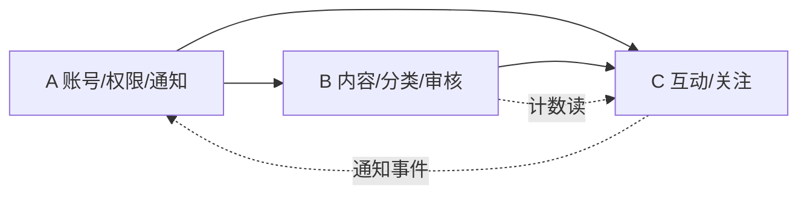

# 轻享图文 · 模块划分与三人分工（M1）

> 目标：把 M1 拆成三个**可独立负责、可独立测试、可独立答辩**的垂直模块。每人从需求、库表、接口、后端、JSP、测试到文档完整走一遍，满足老师“每个人都必须走完整开发流程”的要求。
>
> 配套文档：《产品需求与业务说明书（M1）》《开发规范》《接口文档》《UIUX-小红书》。
>
> **UI 统一口径**：所有模块的 JSP/CSS 按 `docs/UIUX-小红书.md` 实现（白画布、`#333` 文字、`#FF2442` 红、3:4 封面、卡片无边框/阴影、桌面 5/3/2 列、详情双栏弹层）；不再沿用 MonaHub 视觉。

---

## 1. 分工原则

1. **垂直切片，不按技术层切**：每个人负责“表 + 接口 + 页面 + 测试”的一整条链，不做“你只写 Controller、我只写 Mapper”的横向切分。
2. **接口先定契约**：先定 `Result`、分页、错误码、权限码、DTO/VO 字段，再并行开发；契约变更必须三人同步。
3. **共享基础设施有唯一 owner**：配置、统一返回、异常、登录拦截、权限切面由 A 维护；B/C 可以提 PR，但不直接改。
4. **每人至少一张表**：A 拿 `sys_user/role/permission/log`，B 拿 `article/category`，C 拿社交扩展表；六表考核由 A+B 覆盖，C 负责扩展与创新。
5. **每人一套测试**：单元/集成/MockMvc + ApiFox 用例；测试报告进 `docs/test/`。
6. **每周一次集成**：不等到最后一天合并；每周五跑全量 `mvn clean test` + 主链路演示。

---

## 2. 三个模块总览

| 模块 | 负责人 | 业务边界 | 核心表 | 页面 | 关键接口 |
|---|---|---|---|---|---|
| **A 账号、权限与治理** | 成员 A（建议技术负责人） | 注册登录、BCrypt、RBAC、AOP 权限、用户 CRUD、操作日志、站内通知 | `sys_user`、`sys_role`、`sys_permission`、`operation_log`、`notification` | 登录/注册、用户管理、日志、通知中心、个人资料 | `/auth/**`、`/admin/users/**`、`/admin/logs`、`/notifications/**`、`/me/profile` |
| **B 内容、分类与审核** | 成员 B | 图文 CRUD、状态机、分类树、审核/批量/下架、搜索、自动封面/头像上传 | `article`、`category` | 首页信息流、详情、创作、我的内容、审核台、分类管理 | `/articles/**`、`/categories/**`、`/reviews/**`、`/files/**` |
| **C 互动、关注与分发** | 成员 C | 点赞、收藏、评论/回复、关注/粉丝、关注流、减少推荐 | `article_like`、`article_favorite`、`comment`、`user_follow`、`reader_feedback` | 详情互动区、评论区、作者主页、关注流、我的收藏 | `/articles/{id}/like`、`/favorite`、`/comments/**`、`/users/{id}/follow`、`/feedback` |

> 技术负责人默认认领 A：A 是共享契约的源头，先落地能解锁 B/C。若想换，B 与 A 可互换；C 依赖 B 的文章查询，不建议把 C 放第一顺位。
>
> 如果实际是四人（你 + 三名组员），不要把自己只写成“评审”：把你负责的横切工作（架构、安全、测试、部署）也按交付物留痕，或把 A 拆成“账号/权限”与“用户/日志/通知”两个子模块，确保每个人都有自己的完整闭环。老师看的是每个人有没有从需求到测试走一遍。

---

## 3. “完整开发流程”每人交付物

每个模块负责人都必须交齐以下 9 项，缺一项视为该模块未完成：

| 阶段 | 交付物 | 证据 |
|---|---|---|
| 1 需求分析 | 自己模块的用例、边界、验收标准；对应产品文档章节 | `docs/需求-<模块>.md` 或产品文档批注 |
| 2 数据库设计 | 自己表的 DDL、E-R 片段、索引、约束、状态枚举 | `sql/` 对应脚本 + 文档 |
| 3 接口设计 | 自己接口的 URL、入参、出参、错误码；更新接口文档 | `docs/接口文档.md` 对应章节 |
| 4 后端开发 | Controller / Service / Mapper / XML；参数校验、权限、事务 | Git 提交 + 代码评审 |
| 5 前端开发 | 自己模块的 JSP / CSS / JS；空态/错误态/加载态 | 页面截图 `docs/screenshots/<模块>/` |
| 6 测试 | 单元/集成/MockMvc + ApiFox；正常/异常/越权/边界 | `docs/test/<模块>-测试报告.md` |
| 7 联调 | 与上下游模块联调；契约变更记录 | ApiFox 运行截图 / 联调记录 |
| 8 文档与答辩 | 模块说明、AI 交互记录、5 分钟演示脚本 | `docs/ai/`、`docs/demo/<模块>.md` |
| 9 开发文档 | 按模板写 `docs/开发文档-成员X.md`：模块边界、需求、库表、接口、实现、测试、联调、AI、增量记录、自评 | 文档 + 同 PR 提交 |

> 老师检查“是否独立完成”时，看的是：你负责的表、接口、页面、测试、提交记录、AI 调试记录是否形成闭环，而不是看你有没有碰别人的文件。

### 3.1 增量开发与远端

- **增量开发**：每个增量是一个可运行、可测试、可演示的垂直切片（表 + 接口 + 页面 + 测试 + 文档）；禁止最后一次性合并。
- 每个增量结束：`mvn clean test` 绿、主链路能跑、接口文档同步、更新自己的开发文档“增量记录”。
- **统一远端**：`https://github.com/JFT-Group/QingXiangTuWen`；`main` 为集成分支。
- 个人分支：`feat/a-*`、`feat/b-*`、`feat/c-*`；每周五合并；合并前 `git pull --rebase origin main`；禁止 force push `main`。
- 共享文件（`pom.xml`、`config/**`、`Result`、`app.css`、`接口文档.md`）由 owner 合并，其他人提 PR。

---

## 4. 模块 A：账号、权限与治理

### 4.1 范围

- 注册、登录、退出、BCrypt 口令、session、CSRF。
- 三角色 RBAC：`READER` / `CREATOR` / `REVIEWER`；用户单角色、角色直连权限。
- Spring AOP 接口权限：`@RequirePermission` + `PermissionAspect`；页面 302 / API 401/403。
- 用户管理：列表、搜索、新增、编辑、停用/启用、删除、角色分配；最后审核者保护。
- 操作日志：登录/退出、审核、用户、分类、评论治理；只追加。
- 站内通知：通知表、通知服务、未读数、列表、单条/全部已读。
- 个人资料：昵称、头像、简介、改密。

### 4.2 表

`sys_user`、`sys_role`、`sys_permission`、`operation_log`、`notification`。

### 4.3 接口

`/api/v1/auth/**`、`/api/v1/admin/users/**`、`/api/v1/admin/logs`、`/api/v1/notifications/**`、`/api/v1/me/profile`、`/api/v1/me/password`；头像上传使用 B 的 `/api/v1/files/avatar`，不重复实现。

### 4.4 页面

登录/注册、用户管理、操作日志、通知中心、个人资料。

### 4.5 测试

- 注册/登录/错误口令/停用账号/退出。
- 页面 302 vs API 401；AOP 403；越权访问。
- 最后审核者保护、不能删自己、角色变更日志。
- 通知：审核/评论/点赞/收藏/关注各一条；未读数；已读。
- 日志：动作、操作人、对象、结果、理由。

### 4.6 依赖

- 依赖 B/C 在业务动作后调用 `NotificationService.notify(...)`；A 提供接口，不反向依赖 B/C 的 Service。
- 依赖 B 的 `FileStorageService` 存头像；A 只调接口。

---

## 5. 模块 B：内容、分类与审核

### 5.1 范围

- 文章：新建、编辑、删除、草稿、提交、撤回、我的内容。
- 状态机：草稿 / 待审核 / 已发布 / 已驳回 / 已下架；条件更新 + 409。
- 审核：待审列表、详情、通过、驳回、批量通过（批量发布）、批量驳回/下架/删除、重新上架。
- 分类：多级树、新增子分类、编辑、排序、启停、删除约束。
- 搜索：标题/正文/作者关键词、分类子树、分页、排序白名单。
- 自动封面：服务端按标题哈希选 6 色之一，存 `cover_color`；前端 3:4 色块 + 标题 3 行，不请求图片。
- 头像上传：大小/类型/magic bytes/随机名/路径安全。

### 5.2 表

`article`、`category`；文章计数列 `like_count/favorite_count/comment_count` 由 C 更新，B 只读。

### 5.3 接口

`/api/v1/articles/**`（不含 `/following`、`/like`、`/favorite`、`/comments`）、`/api/v1/me/articles`、`/api/v1/categories/**`、`/api/v1/reviews/**`、`/api/v1/admin/articles/{id}/unpublish|republish`、`/api/v1/files/**`（头像/文件访问）。

### 5.4 页面

首页信息流、文章详情（正文部分）、创作页、我的内容、审核台、分类管理。

### 5.5 测试

- 状态机全部合法/非法流转；并发审核 409。
- 批量 3 条中 1 条已处理 → 2 成功 1 失败。
- 分类：多级、父分类筛选、有内容/子分类不能删、最大层级。
- 搜索：只出已发布；关键词/分类组合；排序白名单。
- N+1：列表 join 作者/分类；`EXPLAIN` 命中索引。
- 头像上传：类型/大小/路径穿越/随机名。
- 自动封面：颜色按标题哈希稳定、编辑标题不改色、长标题 3 行省略、无 `` 请求、3/2/1 列不塌陷。

### 5.6 依赖

- 依赖 A 的登录/权限/日志/通知。
- 向 C 提供 `ArticleQueryService`（详情、列表、按作者集合查询）与 `ArticleCountService` 的读接口；C 更新计数列。
- 向 A 提供 `FileStorageService` 存头像。

---

## 6. 模块 C：互动、关注与分发

### 6.1 范围

- 点赞/收藏：幂等、计数、我的收藏、通知。
- 评论/回复：一级 + 一层回复、敏感词、三种删除权限、计数、通知。
- 关注/粉丝：关注/取关、粉丝/关注列表、作者主页、关注流、通知。
- 减少推荐：从当前账号信息流隐藏/恢复。
- 通知触发：在点赞/收藏/评论/回复/关注成功后调用 A 的 `NotificationService`。

### 6.2 表

`article_like`、`article_favorite`、`comment`、`user_follow`、`reader_feedback`；更新 `article.like_count/favorite_count/comment_count`、`sys_user.follower_count/following_count`。

### 6.3 接口

`/api/v1/articles/{id}/like`、`/favorite`、`/api/v1/me/favorites`、`/api/v1/articles/{id}/comments`、`/api/v1/comments/{id}`、`/api/v1/admin/comments/**`、`/api/v1/users/{id}/follow`、`/followers`、`/following`、`/api/v1/articles/following`、`/api/v1/users/{id}`、`/api/v1/users/{id}/articles`、`/api/v1/feedback`。

### 6.4 页面

详情互动区（点赞/收藏/关注）、评论区、作者主页、关注流、我的收藏；评论治理页与 A 的后台布局共用。

### 6.5 测试

- 点赞/收藏重复调用计数不变；取消回退；不为负。
- 评论层级、空/超长/敏感词、三种删除权限、计数回退、通知。
- 关注自己拒绝；重复关注幂等；关注流只出已发布；取关后流更新。
- 减少推荐幂等；只影响当前账号。
- 通知触发：不自通知；接收者正确。

### 6.6 依赖

- 依赖 A 的登录/权限/通知；依赖 B 的文章查询与详情 VO。
- 向 B 提供计数更新；向 A 提供通知事件参数（不直接写 `notification` 表）。

---

## 7. 共享契约（先定，后并行）

| 契约 | Owner | 使用方 | 说明 |
|---|---|---|---|
| `Result<T>` / `PageResult<T>` | A | 全部 | `code` = HTTP 状态；`{code,message,data}` |
| `BusinessException` / 错误码 | A | 全部 | 400/401/403/404/409/413/500 |
| `LoginUser` / `CurrentUser` | A | 全部 | session 中的脱敏用户 + 权限集合 |
| `@RequirePermission` / `PermissionAspect` | A | B/C | 切 Controller；子容器 `@Bean` |
| `NotificationService.notify(...)` | A | B/C | 不给自己发；同事务 |
| `ArticleQueryService` | B | C | 详情、列表、按作者集合查询 |
| `ArticleCountService` | C | B/A | 点赞/收藏/评论计数原子更新 |
| `FileStorageService` | B | A/C | 头像/正文图片；封面自动生成，不走存储 |
| `SensitiveWordFilter` | C | 评论 | 本地词表；命中拒绝 |
| `CsrfToken` | A | 全部页面 | 表单 `_csrf` / fetch `X-CSRF-Token` |

### 7.1 依赖方向

- 代码依赖只允许 A → B/C、B → C；C 不反向 import A/B 的 Mapper，只调 Service 接口。
- 通知是“C/B 调 A 的接口”，不是 C/B 直接写 `notification` 表。

---

## 8. 文件与分支归属

| 文件/目录 | Owner | 规则 |
|---|---|---|
| `pom.xml`、`config/**`、`interceptor/**`、`aspect/permission/**`、`exception/**`、`dto/Result*`、`util/PasswordUtil`、`util/CsrfUtil` | A | B/C 提 PR，A 合并 |
| `article/**`、`category/**`、`review/**`、`file/**`、`controller/page` 的内容/审核页面 | B | B 合并；C 只调 Service |
| `interaction/**`、`comment/**`、`follow/**`、`feedback/**`、社交 JSP/JS | C | C 合并 |
| `notification/**` | A | B/C 只调 `NotificationService` |
| `sql/01_core.sql` | A | — |
| `sql/02_content.sql` | B | — |
| `sql/03_social.sql` | C | — |
| `sql/04_seed.sql` | A + 全员 | 种子数据按模块追加 |
| `static/css/app.css` | A（令牌/布局）+ B/C（各自区块） | 改共享区块需 A review |
| `static/js/app.js` | A（主题/通用）+ B/C（各自页面脚本） | 避免互相覆盖 |
| `docs/接口文档.md` | A（模板/通用）+ B/C（各自章节） | 契约变更三人同步 |

分支：`feat/a-*`、`feat/b-*`、`feat/c-*`；每周五合并到 `main`。共享文件冲突由 owner 解，不允许 `--force` 覆盖。

---

## 9. 四周节奏

| 周 | A | B | C | 周五集成 |
|---|---|---|---|---|
| W1 | 三配置类、登录/注册、RBAC 表、AOP 骨架 | 文章/分类表、文章 CRUD、分类树 | 社交表、点赞/收藏 | 登录 + 文章 CRUD + 点赞能跑 |
| W2 | 用户管理、日志、通知服务 | 状态机、审核、批量、搜索、上传 | 评论/回复、关注、关注流 | 审核 → 发布 → 评论/关注全链路 |
| W3 | 通知中心、个人资料、CSRF | 审核台/分类页/创作页 UI | 详情互动/评论/作者主页 UI | 三端页面联调；修契约 |
| W4 | 权限/通知/日志测试 | 状态机/分类/搜索/N+1 测试 | 幂等/评论/关注测试 | 全量测试、ApiFox、答辩彩排 |

> 关键路径：A 的登录/权限 → B 的文章/审核 → C 的互动。A 第一周不落地，B/C 只能写不能联调。

---

## 10. 评分点覆盖

| 评分点 | 主责 | 协作 |
|---|---|---|
| 需求分析 1 | A | B/C 提供模块用例 |
| 六表/主外键/索引 1.5 | A（user/role/permission/log）+ B（article/category） | C 扩展表 |
| 架构/ER/流程图 1 | A | B/C 提供模块图 |
| 工程结构 0.5 | A | 全员遵守 |
| Spring AOP 权限 2 | A | B/C 标 `@RequirePermission` |
| 多级分类 1.5 | B | A 提供权限 |
| 文章 CRUD/批量/检索/审核 1.5 | B | C 提供计数 |
| 日志/安全/异常/校验 1 | A | B/C 使用统一异常 |
| 高级查询/排序/逻辑删除/自动填充 1 | B | A 提供 MP 配置 |
| MyBatis-Plus 1 | A（配置）+ B（使用） | C 使用 |
| N+1 1 | B | C 评论列表也做批量 |
| RESTful/ApiFox 1 | A（规范）+ 全员 | 每人维护自己接口 |
| 代码规范 3 | 全员 | 互评 |
| AI 痕迹 2 | 全员 | 各自 `docs/ai/` |
| 报告/部署 1 | A | 全员提供模块材料 |

> 社交模块虽然不直接对应评分表条目，但 C 的接口/测试/页面会支撑“RESTful、联调、代码质量、创新”这些分；答辩时把“互动闭环”作为项目亮点讲。

---

## 11. 每人“完成”的判定

- [ ] 自己模块的表已建、索引/外键/约束齐全，能一键初始化。
- [ ] 自己模块的接口在 ApiFox 可跑通，正常/异常/越权都有用例。
- [ ] 自己模块的 JSP 页面可用，空态/错误态/加载态齐全。
- [ ] 自己模块的测试类/用例进 `mvn clean test`，全绿。
- [ ] 自己模块的接口文档章节更新，字段与实现一致。
- [ ] 有至少 1 次跨模块联调记录（谁调用你、你调用谁）。
- [ ] 有 AI 交互/修改痕迹，能讲清“AI 给了什么、你改了什么”。
- [ ] 按模板写完 `docs/开发文档-成员X.md`，增量记录与 commit 对得上。
- [ ] 能独立演示 5 分钟：需求 → 表 → 接口 → 页面 → 测试 → 问题与解决。

---

## 12. 风险与兜底

| 风险 | 影响 | 兜底 |
|---|---|---|
| A 的权限切面放错容器，静默失效 | 所有后台接口裸奔 | 按开发规范放子容器 `@Bean`；W1 用 403 用例证明 |
| B 的状态机用“先查再改” | 并发审核双写 | 条件更新 + 影响行数 0 → 409；并发用例 |
| C 的计数与关系表不一致 | 点赞/评论数错 | 同事务 + 原子 SQL；对账脚本（M2） |
| 通知写入拖慢主流程 | 互动变慢 | 同事务可接受；M2 再异步 |
| 共享 CSS/JS 互相覆盖 | 页面回归 | 区块 owner + 周五集成 + 截图对比 |
| 评论/关注范围膨胀 | 工期失控 | 一级评论 + 一层回复；通知轮询；不做评论图片/举报（M2） |

---

## 13. 一句话分工

- **A 管“谁能进、能做什么、出了事查谁”**：账号、权限、用户、日志、通知。
- **B 管“内容怎么发、怎么审、怎么搜”**：文章、分类、审核、搜索、自动封面。
- **C 管“内容怎么被互动、怎么被关注”**：点赞、收藏、评论、关注、关注流、减少推荐。

三人各自从表到页面到测试走一遍；共享契约先定，每周五集成，最后一周只修 bug 和答辩。
